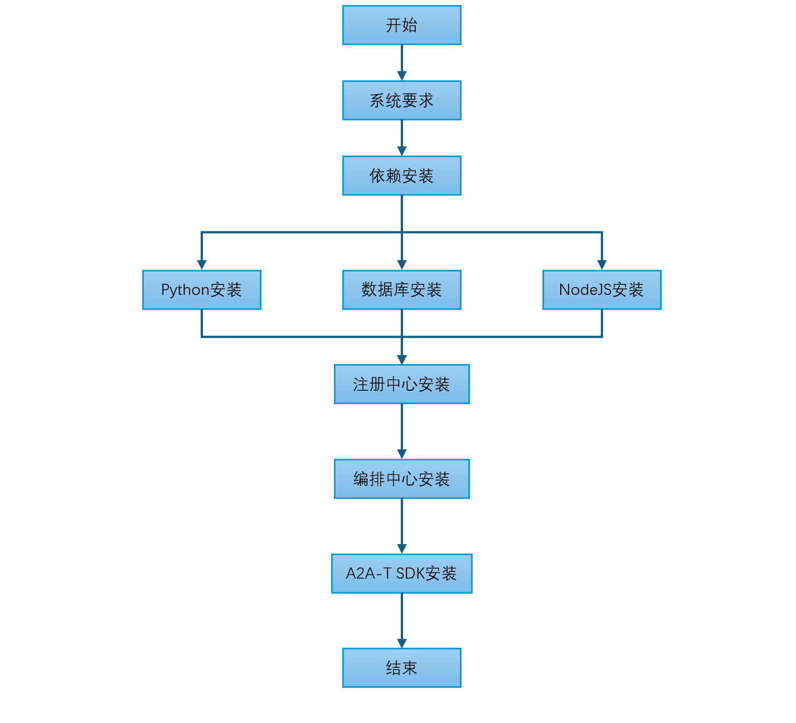
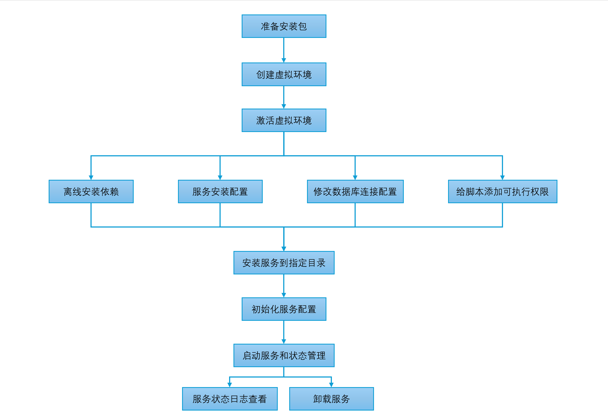

<!--
Copyright (c) 2026 Huawei Technologies Co., Ltd.
All Rights Reserved.

SPDX-License-Identifier: Apache-2.0

   Licensed under the Apache License, Version 2.0 (the "License"); you may
   not use this file except in compliance with the License. You may obtain
   a copy of the License at

        http://www.apache.org/licenses/LICENSE-2.0

   Unless required by applicable law or agreed to in writing, software
   distributed under the License is distributed on an "AS IS" BASIS, WITHOUT
   WARRANTIES OR CONDITIONS OF ANY KIND, either express or implied. See the
   License for the specific language governing permissions and limitations
   under the License.
-->
# OpenAN Manual Installation Guide

English | [中文](../zh/manual-installation-guide.zh.md)

> This guide walks through system preparation, dependency installation, and per-service deployment step by step. After installing via the [Quick Installation Guide](quick-installation-guide.en.md), the corresponding steps here can be skipped; this guide is for scenarios that require custom systemd service management, an existing external database cluster, or source-level per-component deployment.
## 1. System Requirements

The overall installation flow:



This project is developed on Python 3.12. Before compiling and installing, ensure the target system meets the following requirements:

### Operating System

| OS | Minimum version |
|---------|---------|
| Other Linux distributions | Kernel 3.10+ |
| CentOS / RHEL | 7.0+ |
| Ubuntu | 18.04+ |
| Debian | 10+ |

> **Note**: Compiling Python 3.12 requires a compiler with C11 support; GCC 5.0+ is recommended for better optimization. Glibc 2.17 is the minimum requirement for Python 3.12; 2.28+ is recommended for better compatibility.

### Verify System Environment

```bash
# Check GCC version
gcc --version

# Check Make version
make --version

# Check Glibc version
ldd --version
```

| Tool | Minimum | Recommended | Check command |
| ----- |---------|---------|---------|
| GCC | 4.8.5 | 5.0+ | `gcc --version` |
| Make | 3.81 | 4.0+ | `make --version` |
| Glibc | 2.17 | 2.28+ | `ldd --version` |

### Recommended Hardware Resources

| Node type   | Primary | Secondary | vCPU | Memory (GB) | Disk        |
|--------|-------|-------|---------|---------|-----------|
| Registry Center node | 1     | 1     | 2       | 4      | System disk >= 100G |
| Orchestration Center node | 1     | 1     | 2       | 4      | System disk >= 100G |
| Database node  | 1     | 1     | 2       | 4      | System disk >= 100G |

### Minimum Hardware Resources

| Node type   | Primary | Secondary | vCPU | Memory (GB) | Disk        |
|--------|-------|-------|---------|---------|----------|
| Registry Center node | 1     | 0     | 1       | 2      | System disk >= 50G |
| Orchestration Center node | 1     | 0     | 1       | 2      | System disk >= 50G |
| Database node  | 1     | 0     | 1       | 2      | System disk >= 50G |

### Node Requirements

In online environments, nodes must have outbound internet access; in offline environments, download the dependency packages in advance on an internet-connected Linux machine with the same architecture as the target servers (x86_64 or aarch64), then transfer them to the target nodes for installation (see the offline installation options in [Registry Center Service Installation](#3-registry-center-service-installation) and [Orchestration Center Service Installation](#4-orchestration-center-service-installation)).<br>
Nodes can be logged in to as the root user.<br>
The bootstrap node requires the `tar` utility.

> **Notice**: Use clean nodes with no Kubernetes components installed; otherwise version conflicts may cause the installation to fail.

### Pre-Installation Checklist

- [ ] OS and kernel meet the [Operating System](#operating-system) table; GCC / Make / Glibc meet the [version requirements](#verify-system-environment)
- [ ] Hardware meets the [recommended resources](#recommended-hardware-resources) for the role (or the [minimum](#minimum-hardware-resources))
- [ ] Clean target nodes: no Kubernetes components pre-installed (cluster installs only); `tar` available
- [ ] Online: nodes reach the internet; offline: all artifacts (dependencies / offline package / bundle) prepared on a same-arch internet-connected machine
- [ ] Cluster installs (containerized online / offline): kubectl with admin rights; the offline method additionally requires per-node containerd trust for the private registry (see [DEPENDENCIES §2.2](../../containerized/offline-install/docs/DEPENDENCIES.md))

## 2. Dependency Installation

This project is developed on Python 3.12. Before compiling and installing, ensure the component dependencies meet the following requirements:

| Component | Version | Description | Official download |
| ---------- | ---------- |------| -------------------------------------------- |
| Python | >= 3.12.11 | Project language | https://www.python.org/ftp/python/3.12.11/Python-3.12.11.tgz |
| PostgreSQL | >= 15.6 | Database service | https://ftp.postgresql.org/pub/source/v15.6/postgresql-15.6.tar.gz |
| NodeJS | >= 20.19 | Orchestration Center frontend dependency | https://nodejs.org/dist/v22.19.0/node-v22.19.0-linux-x64.tar.xz |

> Offline installation guidance for each component follows; skip if the component is already installed at a satisfying version. PostgreSQL is used as the database example here — choose the database per your scenario.

### 2.1 Offline Python Installation

Check whether python is installed and its version is 3.12.11; if so, skip the steps below.

```bash
python3 --version   # Check python version
```

1. Download the package.

On an internet-connected Linux server, run the following command to obtain the package (on Windows, download directly from the website).

```bash
wget https://www.python.org/ftp/python/3.12.11/Python-3.12.11.tgz
```

Transfer `Python-3.12.11.tgz` to the target server.

2. Extract the package.

```bash
tar -xzf Python-3.12.11.tgz
cd Python-3.12.11
```

3. Configure the installation path.

```bash
# Install to /usr/local/python312 to avoid replacing the system Python
./configure --prefix=/usr/local/python312 --enable-optimizations
```

4. Compile and install.

```bash
make -j 4
sudo make altinstall
```

5. Create symlinks.

```bash
# python3 symlink
sudo ln -sf /usr/local/python312/bin/python3 /usr/local/bin/python3

# pip3 symlink
sudo ln -sf /usr/local/python312/bin/pip3 /usr/local/bin/pip3
```

6. Verify the installation.

```bash
python3 --version   # Should print Python 3.12.11
pip3 --version
```

**Notes**

- The install path `/usr/local/python312` does not affect the system Python.
- Symlinks under `/usr/local/bin` take lower priority than `/usr/bin`.
- The system `python` or `python2` commands remain unchanged.

### 2.2 Offline Database Installation

PostgreSQL is the default database; you may choose another per your scenario. The following uses PostgreSQL as the example:

Check whether PostgreSQL is installed and its version is 15.6; if so, skip the steps below.

```bash
psql --version
```

1. Download the package.

On an internet-connected Linux server, run the following command to obtain the package (on Windows, download directly from the website).

```bash
wget https://ftp.postgresql.org/pub/source/v15.6/postgresql-15.6.tar.gz
```

Transfer `postgresql-15.6.tar.gz` to the target server.

2. Extract the package.

```bash
tar -xzf postgresql-15.6.tar.gz
cd postgresql-15.6
```

3. Configure the installation path.

```bash
# Install to /usr/local/pgsql
./configure --prefix=/usr/local/pgsql --without-readline
```

Common configure options:
- `--prefix=/usr/local/pgsql`: installation path.
- `--with-openssl`: enable SSL support.
- `--with-readline`: enable readline support (enabled by default).
- `--with-zlib`: enable zlib support (enabled by default).

4. Compile and install.

```bash
make -j 4
sudo make install
```

5. Create the postgres user.

```bash
sudo useradd postgres
```

6. Create the data directory and grant ownership.

```bash
sudo mkdir -p /usr/local/pgsql/data
sudo chown -R postgres:postgres /usr/local/pgsql/data
```

7. Initialize the database.

```bash
su - postgres # switch to the postgres user
/usr/local/pgsql/bin/initdb -D /usr/local/pgsql/data
```

8. Start the PostgreSQL service.

```bash
# Switch to the postgres user
su - postgres

# Start in foreground
/usr/local/pgsql/bin/pg_ctl -D /usr/local/pgsql/data -l /usr/local/pgsql/data/logfile start

# Add to PATH
echo "export PATH=/usr/local/pgsql/bin:\$PATH" >> ~/.bashrc
source ~/.bashrc

# Confirm startup
psql -l

# Check version
/usr/local/pgsql/bin/psql --version

# Connect
/usr/local/pgsql/bin/psql -c "SELECT version();"
```

Enter `exit` to leave the `postgres` user.

9. Configure the systemd service (optional).

```bash
sudo tee /etc/systemd/system/postgresql.service << EOF
[Unit]
Description=PostgreSQL 15 Database Server
After=network.target

[Service]
Type=forking
User=postgres
Group=postgres
Environment=PGDATA=/usr/local/pgsql/data
ExecStart=/usr/local/pgsql/bin/pg_ctl start -D /usr/local/pgsql/data -l /usr/local/pgsql/data/logfile
ExecStop=/usr/local/pgsql/bin/pg_ctl stop -D /usr/local/pgsql/data
ExecReload=/usr/local/pgsql/bin/pg_ctl reload -D /usr/local/pgsql/data
PIDFile=/usr/local/pgsql/data/postmaster.pid
TimeoutSec=300

[Install]
WantedBy=multi-user.target
EOF

sudo systemctl daemon-reload
sudo systemctl enable postgresql
sudo systemctl start postgresql
```

10. Create the database and user.

```bash
# Switch to the postgres user
su - postgres

# Enter the SQL shell
psql
```

Run in psql:

```sql
CREATE USER registry_user WITH ENCRYPTED PASSWORD 'your_password' CREATEDB;
```

11. Configure remote access (as root).

- Edit `/usr/local/pgsql/data/pg_hba.conf`, appending:

```bash
# Allow remote connections
host    all             all             0.0.0.0/0               scram-sha-256
```

- Edit `/usr/local/pgsql/data/postgresql.conf`:

```bash
# Listen address
listen_addresses = '*'
```

- Restart the service:

```bash
# Restart via systemctl (recommended)
sudo systemctl restart postgresql

# Or reload with pg_ctl
su - postgres -c "/usr/local/pgsql/bin/pg_ctl -D /usr/local/pgsql/data restart"
```

**Notes**

- PostgreSQL listens on port 5432 by default.
- Change the default password in production.
- Restrict database access with firewall rules.
- Back up the database regularly.

### 2.3 Offline NodeJS Installation

Check whether NodeJS is installed and the version meets ≥ 20.19; this guide uses v22.19.0 as the example — skip the steps below if already satisfied.

```bash
node --version   # Should print v22.19.0
```

1. Download the package.

NodeJS uses prebuilt binaries; pick the package matching the target server architecture. On an internet-connected Linux server, run the following commands to obtain the package (on Windows, download directly from the website).

x86_64:

```bash
wget https://nodejs.org/dist/v22.19.0/node-v22.19.0-linux-x64.tar.xz
```

aarch64:

```bash
wget https://nodejs.org/dist/v22.19.0/node-v22.19.0-linux-arm64.tar.xz
```

Transfer the downloaded `.tar.xz` package to the target server.

2. Extract the package.

Extract to `/usr/local/` according to the downloaded package name:

```bash
# x86_64:
tar -xJf node-v22.19.0-linux-x64.tar.xz -C /usr/local/
mv /usr/local/node-v22.19.0-linux-x64 /usr/local/nodejs

# aarch64:
# tar -xJf node-v22.19.0-linux-arm64.tar.xz -C /usr/local/
# mv /usr/local/node-v22.19.0-linux-arm64 /usr/local/nodejs
```

3. Configure environment variables.

```bash
# Add NodeJS to PATH
echo "export PATH=/usr/local/nodejs/bin:\$PATH" >> ~/.bashrc
source ~/.bashrc
```

4. Verify the installation.

```bash
node --version   # Should print v22.19.0
npm --version
```

**Notes**

- NodeJS ships as prebuilt binaries with no compile toolchain required; the architecture must match the target server (`linux-x64` for x86_64, `linux-arm64` for aarch64).
- Default install path is `/usr/local/nodejs`.
- Use nvm to manage multiple NodeJS versions in production.
- **Note**: NodeJS is only needed for building the Orchestration Center frontend; in production the frontend is served by nginx as static assets, so NodeJS is not required on a deployment-only target server.

## 3. Registry Center Service Installation


1. Obtain the source code.

**Online**:

```bash
git clone https://github.com/project-openan/registry-center.git
cd registry-center
```

**Offline**: clone the source on an internet-connected machine, package it, and transfer to the target server.

```bash
# On the internet-connected machine
git clone https://github.com/project-openan/registry-center.git
tar -czf registry-center.tar.gz registry-center/

# Transfer registry-center.tar.gz to the target server and extract
tar -xzf registry-center.tar.gz
cd registry-center
```

2. Create a virtual environment.

```bash
# Create a venv with the installed Python 3.12
python3 -m venv venv --copies
```

3. Activate the virtual environment.

```bash
source venv/bin/activate
```

The prompt prefix shows `(venv)` once activated.

4. Install dependencies.

**Online**: install directly with the venv activated.

```bash
pip install -r ./requirements.txt
```

**Offline**: the target server cannot reach the internet, so download the wheel packages in advance on an internet-connected Linux machine of the same architecture (x86_64 or aarch64).

- On the internet-connected machine:

```bash
# Wheel storage directory
mkdir -p ./wheels

# Check machine architecture
uname -m   # x86_64 or aarch64

# Download all dependency wheels (requires a Python 3.12 environment)
# x86_64:
pip download -r ./requirements.txt -d ./wheels \
  --platform manylinux2014_x86_64 \
  --python-version 3.12 \
  --only-binary=:all:

# aarch64:
# pip download -r ./requirements.txt -d ./wheels \
#   --platform manylinux2014_aarch64 \
#   --python-version 3.12 \
#   --only-binary=:all:

# Package the wheels
tar -czf registry-center-wheels.tar.gz ./wheels
```

- Transfer `requirements.txt` and `registry-center-wheels.tar.gz` to the target server, then:

```bash
tar -xzf registry-center-wheels.tar.gz
source venv/bin/activate
pip install --no-index --find-links=./wheels -r ./requirements.txt
```

> **Note**: `--platform manylinux2014` ensures the wheels run on any glibc 2.17+ system (CentOS 7 / Ubuntu 18.04 and later). `--only-binary=:all:` downloads prebuilt wheels only; if some package has no manylinux wheel and the download fails, drop this flag to download the source distribution (sdist) and compile it on the target server (requires GCC and other build tools).

5. Service installation configuration (optional).

Edit `./etc/systemd/deploy.conf` to configure the deployment directory and more.

```bash
vi ./etc/systemd/deploy.conf

# Registry Center deployment configuration
# Copyright (c) 2026 Huawei Technologies Co., Ltd.

# Deployment directory (service install location)
INSTALL_DIR=/OpenA2A-T/registry-center

# Python path (empty = use INSTALL_DIR/venv/bin/python3)
PYTHON_PATH=

# Service name
SERVICE_NAME=registry-center

# Auto-install dependencies (recommended: true, uses pip)
INSTALL_DEPS=true
```

> Exit vi: press Esc, type `:wq!`

6. Update the database connection configuration.

Edit the Registry Center configuration file `./etc/conf/persistence.conf`:

- Set `postgresql.host` to the database node IP.
- Set `postgresql.port` to the PostgreSQL port (default `5432`).
- Set `postgresql.username` / `postgresql.password` to the actual database credentials.

7. Grant execute permission to the scripts.

```bash
chmod +x ./bin/*.sh
```

8. Install the service to the target directory.

```bash
# Install to the INSTALL_DIR configured in step 3.2.5
sudo ./bin/install_service.sh install

# Expected success output:
# Installing the project to /OpenA2A-T/registry-center...
# Files copied successfully
# Deploy Configuration:
#   Install Dir: /OpenA2A-T/registry-center
#   Python Path: /OpenA2A-T/registry-center/venv/bin/python3
#   Install Deps: false
#
# Using Python: /OpenA2A-T/registry-center/venv/bin/python3
# Python 3.12.11
# Service installed successfully!
```

9. Initialize the service configuration.

```bash
# Enter the service installation directory
cd /OpenA2A-T/registry-center

# Initialize the service configuration
./venv/bin/python3 -m agent_registry.init
```

The service supports HTTPS and AgentCard signing/verification; **you may decline these on first start and configure them later as needed**.

```bash
是否开启HTTPS enable_https (y/n, 默认: true): n
是否需要提供注册中心签名配置 registry.sign.enabled (y/n, 默认: true): n
是否开启验签能力 signature_validation_enabled (y/n, 默认: true): n

==================================================
持久化存储配置
==================================================

请选择存储模式 persistence.mode (file/postgresql, 默认: postgresql): file

配置已完成，已保存在 /OpenA2A-T/registry-center/etc/conf/server.conf
```

10. Start the service and manage its state.

```bash
systemctl start registry-center
systemctl status registry-center
systemctl stop registry-center
```

11. View service logs.

```bash
journalctl -u registry-center
journalctl -u registry-center -f
```

12. Uninstall the service.

```bash
sudo ./bin/install_service.sh uninstall
```

## 4. Orchestration Center Service Installation



1. Obtain the source code.

**Online**:

```bash
git clone https://github.com/project-openan/orchestration-center.git
cd orchestration-center
```

**Offline**: clone the source on an internet-connected machine, package it, and transfer to the target server.

```bash
# On the internet-connected machine
git clone https://github.com/project-openan/orchestration-center.git
tar -czf orchestration-center.tar.gz orchestration-center/

# Transfer orchestration-center.tar.gz to the target server and extract
tar -xzf orchestration-center.tar.gz
cd orchestration-center
```

2. Create a virtual environment.

```bash
python3 -m venv venv --copies
```

3. Activate the virtual environment.

```bash
source venv/bin/activate
```

4. Install dependencies.

**Online**:

```bash
pip install -r ./requirements.txt
```

**Offline**: download the wheels on an internet-connected Linux machine of the same architecture (x86_64 or aarch64).

- On the internet-connected machine:

```bash
mkdir -p ./wheels
uname -m

# x86_64:
pip download -r ./requirements.txt -d ./wheels \
  --platform manylinux2014_x86_64 \
  --python-version 3.12 \
  --only-binary=:all:

# aarch64:
# pip download -r ./requirements.txt -d ./wheels \
#   --platform manylinux2014_aarch64 \
#   --python-version 3.12 \
#   --only-binary=:all:

tar -czf orchestration-center-wheels.tar.gz ./wheels
```

- Transfer `requirements.txt` and `orchestration-center-wheels.tar.gz` to the target server, then:

```bash
tar -xzf orchestration-center-wheels.tar.gz
source venv/bin/activate
pip install --no-index --find-links=./wheels -r ./requirements.txt
```

> **Note**: `--platform manylinux2014` ensures the wheels run on any glibc 2.17+ system. `--only-binary=:all:` downloads prebuilt wheels only; if some package has no manylinux wheel, drop the flag to download sdists and compile on the target server.

5. Service installation configuration (optional).

```bash
vi ./etc/systemd/deploy.conf

# Orchestration Center deployment configuration
# Copyright (c) 2026 Huawei Technologies Co., Ltd.

# Deployment directory (service install location)
INSTALL_DIR=/OpenA2A-T/orchestration-center

# Python path (empty = use INSTALL_DIR/venv/bin/python3)
PYTHON_PATH=

# Service name
SERVICE_NAME=orchestration-center

# Auto-install dependencies (recommended: true, uses pip)
INSTALL_DEPS=true
```

> Exit vi: press Esc, type `:wq!`

6. Update the database connection configuration.

Edit the Orchestration Center configuration file `./etc/conf/db_config.json`:

- Set `host` to the PostgreSQL database node IP.
- Set `port` to the PostgreSQL port (default `5432`).
- Set `user` / `password` to the actual database credentials.

7. Grant execute permission to the scripts.

```bash
chmod +x ./bin/*.sh
```

8. Install the service to the target directory.

```bash
# Install to the INSTALL_DIR configured in step 3.3.5
sudo ./bin/install_service.sh install

# Expected success output:
# Installing the project to /OpenA2A-T/orchestration-center...
# Files copied successfully
# Deploy Configuration:
#   Install Dir: /OpenA2A-T/orchestration-center
#   Python Path: /OpenA2A-T/orchestration-center/venv/bin/python3
#   Install Deps: false
#
# Using Python: /OpenA2A-T/orchestration-center/venv/bin/python3
# Python 3.12.11
# Service installed successfully!
```

9. Initialize the service configuration (database required).

```bash
cd /OpenA2A-T/orchestration-center
vi ./etc/conf/server.conf   # Configure port, enable_https, etc.
```

HTTPS support is under development and disabled by default. To enable it, set `enable_https` to `true`, ensure SSL certificates are configured, and restart the service.

```bash
# Set enable_https=false
:wq!
```

10. Start the service and manage its state.

```bash
systemctl start orchestration-center
systemctl status orchestration-center
systemctl stop orchestration-center
```

11. View service logs.

```bash
journalctl -u orchestration-center
journalctl -u orchestration-center -f
```

12. Uninstall the service.

```bash
sudo ./bin/install_service.sh uninstall
```

## 5. Orchestration Center Frontend Deployment

The Orchestration Center frontend is a React single-page application whose source ships inside the orchestration-center repository. After completing [Orchestration Center Service Installation](#4-orchestration-center-service-installation), the frontend code is already installed.

> **Note**: an air-gapped target node has no reachable npm registry — **never** run `npm install` on it; build and package the `dist/` assets on an internet-connected machine (see Production mode below), transfer them to the offline node, and serve them via nginx.

**Development mode** (requires NodeJS; for debugging):

```bash
cd {install-dir}/orchestration-center/workflow-designer
npm install --force
npm run dev
```

Access at `http://localhost:3003` once started.

**Production mode** (recommended; no NodeJS required): build the static assets and serve them via nginx.

- Build on a development machine with NodeJS:

```bash
cd orchestration-center/workflow-designer
npm install --force
npm run build      # Produces dist/
tar -czf workflow-designer-dist.tar.gz dist/
```

- Transfer `workflow-designer-dist.tar.gz` to the target server, extract it into the Orchestration Center installation directory, and configure nginx. The following is a complete reference nginx configuration; adjust the entries annotated with `<-- adjust as needed` for your environment:

```nginx
user nginx                              # <-- adjust to the actual run user
worker_processes  1;                    # <-- scale with CPU cores
events {
    worker_connections  1024;           # <-- adjust as needed
}

http {
    include       mime.types;
    default_type  application/octet-stream;
    sendfile        on;
    keepalive_timeout  65;

    # Orchestration Center backend cluster; set actual backend addresses
    upstream orchestrate_backend {
        server 127.0.0.1:5001 max_fails=3 fail_timeout=30s;  # <-- actual backend IP:port; add multiple nodes as needed
    }

    server {
        listen       80;                # <-- adjust listen port as needed
        server_name  localhost;         # <-- actual domain or IP

        # Frontend static assets
        location / {
            root   /path/to/orchestration-center/dist;  # <-- actual dist path
            index  index.html index.htm;
            try_files $uri $uri/ /index.html;           # SPA routing
        }

        # Orchestration Center API reverse proxy
        location /api/orchestrate/ {
            proxy_pass http://orchestrate_backend/;
            proxy_set_header Host $host;
            proxy_set_header X-Real-IP $remote_addr;
            proxy_set_header X-Forwarded-For $proxy_add_x_forwarded_for;
            proxy_set_header X-Forwarded-Proto $scheme;

            proxy_connect_timeout 5s;    # <-- adjust as needed
            proxy_send_timeout 180s;     # <-- adjust as needed
            proxy_read_timeout 180s;     # <-- adjust as needed
            proxy_next_upstream error timeout http_500 http_502 http_503;
        }
    }
}
```

> **Configuration notes**: replace `root /path/to/orchestration-center/dist` with the actual dist directory path. Replace `127.0.0.1:5001` in `upstream` with the actual Orchestration Center backend address (`127.0.0.1` for local deployment, intranet IP for remote). Adjust the remaining options (port, timeouts, etc.) per your network environment.

> **Note**: the production build mode is recommended; NodeJS is not required on the target server.

## 6. A2A-T SDK Offline Installation

The A2A-T SDK comes in two flavors — a2a-t-sdk-python and a2a-t-sdk-java — implementing the A2A-T protocol for Python and Java. a2a-t-sdk-python provides task prompt generation, prompt validation, and multi-round negotiation for client-side and server-side Agents; a2a-t-sdk-java provides client prompt generation, server prompt validation, a negotiation runtime, and A2A Java integration samples for Java Agents.

- a2a-t-sdk-python

[Installation and configuration: see the Python SDK user guide](https://github.com/project-openan/a2a-t-sdk-python/blob/main/docs/zh/%E7%94%A8%E6%88%B7%E6%8C%87%E5%8D%97.md)

The Python SDK source is in the `a2a-t-sdk-python` repository; end-to-end demos are in `a2a-t-samples`. Prepare Python 3.12+ and a working LLM endpoint and API key before running.

- a2a-t-sdk-java

[Installation and configuration: see the Java SDK user guide](https://github.com/project-openan/a2a-t-sdk-java/blob/main/docs/zh/%E7%94%A8%E6%88%B7%E6%8C%87%E5%8D%97.md)

The Java SDK source and samples are in the `a2a-t-sdk-java` repository. Prepare JDK 17+, Maven, and a working LLM endpoint and API key before running.
