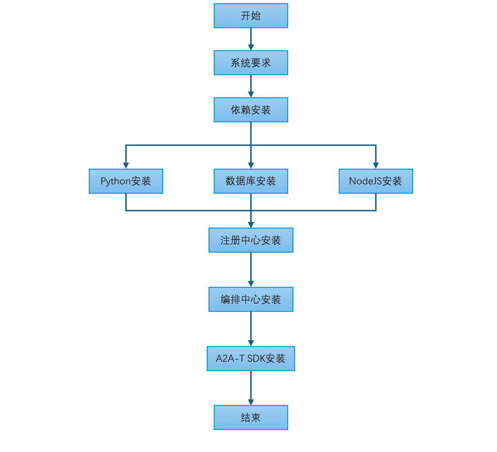

<!--
Copyright (c) 2026 Huawei Technologies Co., Ltd.
All Rights Reserved.

SPDX-License-Identifier: Apache-2.0

   Licensed under the Apache License, Version 2.0 (the "License"); you may
   not use this file except in compliance with the License. You may obtain
   a copy of the License at

        http://www.apache.org/licenses/LICENSE-2.0

   Unless required by applicable law or agreed to in writing, software
   distributed under the License is distributed on an "AS IS" BASIS, WITHOUT
   WARRANTIES OR CONDITIONS OF ANY KIND, either express or implied. See the
   License for the specific language governing permissions and limitations
   under the License.
-->
# OpenAN Quick Installation Guide

English | [中文](../zh/quick-installation-guide.zh.md)

> This guide deploys OpenAN quickly with the system-level installers from openan-installation: a single command installs, verifies, and uninstalls the platform — no manual runtime or dependency preparation. For full control over deployment details (custom systemd services, an existing external database, source-level deployment), see the [Manual Installation Guide](manual-installation-guide.en.md).
## 1. System Requirements

The overall installation flow:



This project is developed on Python 3.12. Before compiling and installing, ensure the target system meets the following requirements:

### Operating System

| OS | Minimum version |
|---------|---------|
| Other Linux distributions | Kernel 3.10+ |
| CentOS / RHEL | 7.0+ |
| Ubuntu | 18.04+ |
| Debian | 10+ |

> **Note**: Compiling Python 3.12 requires a compiler with C11 support; GCC 5.0+ is recommended for better optimization. Glibc 2.17 is the minimum requirement for Python 3.12; 2.28+ is recommended for better compatibility.

### Verify System Environment

```bash
# Check GCC version
gcc --version

# Check Make version
make --version

# Check Glibc version
ldd --version
```

| Tool | Minimum | Recommended | Check command |
| ----- |---------|---------|---------|
| GCC | 4.8.5 | 5.0+ | `gcc --version` |
| Make | 3.81 | 4.0+ | `make --version` |
| Glibc | 2.17 | 2.28+ | `ldd --version` |

### Recommended Hardware Resources

| Node type   | Primary | Secondary | vCPU | Memory (GB) | Disk        |
|--------|-------|-------|---------|---------|-----------|
| Registry Center node | 1     | 1     | 2       | 4      | System disk >= 100G |
| Orchestration Center node | 1     | 1     | 2       | 4      | System disk >= 100G |
| Database node  | 1     | 1     | 2       | 4      | System disk >= 100G |

### Minimum Hardware Resources

| Node type   | Primary | Secondary | vCPU | Memory (GB) | Disk        |
|--------|-------|-------|---------|---------|----------|
| Registry Center node | 1     | 0     | 1       | 2      | System disk >= 50G |
| Orchestration Center node | 1     | 0     | 1       | 2      | System disk >= 50G |
| Database node  | 1     | 0     | 1       | 2      | System disk >= 50G |

### Node Requirements

In online environments, nodes must have outbound internet access; in offline environments, download the dependency packages in advance on an internet-connected Linux machine with the same architecture as the target servers (x86_64 or aarch64), then transfer them to the target nodes for installation (see the offline installation options in [Registry Center Service Installation](#3-registry-center-service-installation) and [Orchestration Center Service Installation](#4-orchestration-center-service-installation)).<br>
Nodes can be logged in to as the root user.<br>
The bootstrap node requires the `tar` utility.

> **Notice**: Use clean nodes with no Kubernetes components installed; otherwise version conflicts may cause the installation to fail.

### Pre-Installation Checklist

- [ ] OS and kernel meet the [Operating System](#operating-system) table; GCC / Make / Glibc meet the [version requirements](#verify-system-environment)
- [ ] Hardware meets the [recommended resources](#recommended-hardware-resources) for the role (or the [minimum](#minimum-hardware-resources))
- [ ] Clean target nodes: no Kubernetes components pre-installed (cluster installs only); `tar` available
- [ ] Online: nodes reach the internet; offline: all artifacts (dependencies / offline package / bundle) prepared on a same-arch internet-connected machine
- [ ] Cluster installs (containerized online / offline): kubectl with admin rights; the offline method additionally requires per-node containerd trust for the private registry (see [DEPENDENCIES §2.2](../../containerized/offline-install/docs/DEPENDENCIES.md))

## 2. Comparison and Selection

openan-installation provides unified system-level installation tools covering both "standalone binary" and "clustered containerized" target environments, with modular component selection (Registry Center only / Orchestration Center + frontend / full stack) and centralized variable configuration (keys, certificates, image registry, network parameters). Choose the method by target environment:

| Method | Target environment | Prerequisites | Entry point | Documentation |
|---|---|---|---|---|
| Binary one-click installation | Internet-connected standalone / dev environment | Linux (root), curl, internet access | `binary/one-click/install.sh` | [QUICKSTART](../../binary/one-click/QUICKSTART.md) |
| Binary offline installation | Air-gapped standalone / VM | Offline package, root | `binary/offline-install/install.sh` | [QUICKSTART](../../binary/offline-install/QUICKSTART.md) |
| Containerized online installation | Internet-connected Kubernetes cluster (v1.33+) | kubectl / Helm, cluster admin | `containerized/online-install/install.sh` | [QUICKSTART](../../containerized/online-install/QUICKSTART.md) |
| Containerized offline installation | Air-gapped Kubernetes cluster (v1.33+) | Build the offline bundle on an internet-connected machine, kubectl | `containerized/offline-install/scripts/install.sh --config config.env` | [QUICKSTART](../../containerized/offline-install/QUICKSTART.md) |
| Offline Compose installation | Air-gapped standalone with containers | Docker (Compose v2.20+), Python 3.10+ | `scripts/install.sh --config config.env` | [QUICKSTART](../../containerized/offline-install-compose/QUICKSTART.md) |

Every method follows the same step pattern: **prepare → configure → install → verify → uninstall**.

> **Quick selection**: dev experience / internet standalone → 2.1 (air-gapped standalone → 2.2); air-gapped standalone with containers → 2.5; internet production cluster → 2.3; air-gapped production cluster → 2.4; systemd customization, external database, or source-level deployment → the [Manual Installation Guide](manual-installation-guide.en.md).

### 2.1 Binary One-Click Installation (Online)

For developers and lightweight evaluation: automatically detects and installs Python 3.12+ / Node.js 20.19+ / nginx / openssl (skips if present, three-tier fallback if missing), downloads the registry-center and orchestration-center release artifacts, and configures a unified nginx HTTPS entry (`/`, `/api/orchestrate/`, `/registry/` routes).

- **Prepare**: a Linux host with internet access (GitHub / PyPI / Node official sources) and root privileges.
- **Configuration** (interactive prompts during installation, all with defaults — press Enter to accept):
  - Component selection: `--reg` / `--orc` (passed on the command line; default full stack; a remote RC address is required when installing OC only)
  - LLM endpoint: model name / API URL / API Key (masked input; skippable, configurable after installation)
  - Database password, admin password and other secrets
- **Install**:

```bash
git clone https://github.com/project-openan/openan-installation.git
cd openan-installation/binary/one-click
./install.sh                 # Interactive; --reg / --orc select components, default full stack
```

- **Verify**: the installer self-checks process liveness and port listening (printing PIDs and log paths); then verify the unified entry:

```bash
curl -sk -o /dev/null -w '%{http_code}\n' \
  https://127.0.0.1/registry/rest/v1/registry-center/agent-cards   # expect non-5xx
```

Opening `https://<host-IP>/` in a browser should show the frontend.

- **Uninstall**:

```bash
./uninstall.sh               # Removes project dir and nginx config; keeps Python/Node/nginx runtimes for fast reinstall
```

Full details: [binary/one-click/QUICKSTART.md](../../binary/one-click/QUICKSTART.md).

### 2.2 Binary Offline Installation (Air-Gapped Standalone / VM)

For air-gapped standalone delivery: the offline package ships venvs and frontend artifacts; runtime installation, port-conflict cleanup, and nginx entry configuration are fully automated — the flow matches the one-click installer.

- **Prepare**: the offline package (built on an internet-connected machine via `binary/build`, or hand-packaged per [binary/build/QUICKSTART](../../binary/build/QUICKSTART.md)).
- **Configuration**: same as 2.1 (interactive prompts; LLM endpoint skippable).
- **Install**:

```bash
tar -xzf openan-binary-offline-<version>.tar.gz   # Offline package
cd openan-binary-offline-<version>
./install.sh                 # Same flags as one-click
./configure_llm.sh --reg --orc   # Configure / reconfigure LLM after install (validation + masked input)
```

- **Verify**: same as 2.1 (process/port self-check + unified-entry API smoke).
- **Uninstall**:

```bash
./uninstall.sh               # Keeps the runtime toolchain for faster reinstalls
```

Full details: [binary/offline-install/QUICKSTART.md](../../binary/offline-install/QUICKSTART.md).

### 2.3 Containerized Online Installation (Kubernetes)

For production clusters with internet access: Helm-based with modular component selection and fully configurable database, protocol, certificate, and image registry parameters; supports an interactive wizard or unattended `--values` automation.

- **Prepare**: a Kubernetes **v1.33+** cluster, kubectl access, and cluster-admin privileges; helm can be auto-installed by the wizard when missing (official sources, with confirmation).
- **Configuration** (interactive wizard or a `--values` deployment file):
  - Release name / namespace; component switches (registry / orchestration / frontend)
  - Image tags and frontend type (`portal` / `workflow-designer`)
  - Database: in-cluster PostgreSQL, or external MySQL / PostgreSQL connection info and credential Secrets
  - LLM endpoints: chat / embed / rerank models (the wizard writes models.yaml and creates Secrets)
  - Admin initial password (`OC_ADMIN_INITIAL_PASSWORD`) and registry access token
  - Ingress host and TLS (optional)
- **Install**:

```bash
git clone https://github.com/project-openan/openan-installation.git
cd openan-installation/containerized/online-install
./install.sh                     # Interactive wizard
# Or unattended: ./install.sh --values <deployment file>
```

- **Verify**:

```bash
helm status openan -n openan
kubectl -n openan get pods       # All Running / Ready
curl -s -o /dev/null -w '%{http_code}\n' \
  http://<ingress-IP>/registry/rest/v1/registry-center/agent-cards   # expect non-5xx
```

> Entry protocol: HTTP by default; if ingress TLS was enabled at deploy time (`ingress.tls.enabled` + certificate Secret), use `https://<ingress-address>/` instead (`ingress.host` may be a DNS name or an IP; add `-k` or `--cacert <CA>` for self-signed certificates). The in-cluster service-to-service TLS (enabled by default on the offline line) is invisible to curl.

- **Uninstall**:

```bash
./uninstall.sh                   # One-command uninstall; choose whether to clean up data
```

Full details: [containerized/online-install/QUICKSTART.md](../../containerized/online-install/QUICKSTART.md).

### 2.4 Containerized Offline Installation (Kubernetes Offline Bundle)

For air-gapped production clusters: build a self-contained bundle (images, Helm, toolchain all pinned) on an internet-connected machine, transfer it to the offline cluster, and install with a single command — the installer bootstraps an in-cluster private registry, installs MetalLB and ingress-nginx offline, deploys via Helm, and runs self-checks. In-cluster TLS is enabled by default.

- **Prepare**:
  - Internet-connected build machine: Docker + internet access (for building the bundle)
  - Offline cluster: kubeadm-built **v1.33+**; **every node's** containerd already trusts the in-cluster registry `<REGISTRY_NODE_IP>:30500` (see [DEPENDENCIES §2.2](../../containerized/offline-install/docs/DEPENDENCIES.md))
  - Install node: kubectl access, ≥ 20 GB free disk
- **Configuration** (`config.env` key items — `cp config.env.example config.env`, then fill in):
  - `METALLB_POOL`: bare-metal LB address pool (e.g. `192.168.1.200-192.168.1.250`)
  - `DB_PASSWORD`: database password, required, ≥ 8 characters
  - `OC_ADMIN_PASSWORD`: portal admin initial password, required
  - `REGISTRY_CHAT_*` / `ORCH_CHAT_*`: LLM endpoints (connectivity is not validated offline by default)
  - `HTTPS_ENABLED`: defaults to `true` (self-signed certificates generated at install time)
  - Optional: `INGRESS_HOST`, `STORAGE_MODE` / `STORAGE_CLASS`
- **Install**:

```bash
# Internet-connected build machine
cd openan-installation/containerized/offline-install/build
./build-offline.sh --tag v1.0.0 --app-source pull

# Offline cluster (after copying the tarball)
tar -xzf openan-offline-v1.0.0.tar.gz && cd openan-offline-v1.0.0
cp config.env.example config.env   # Fill per above
sudo scripts/install.sh --config config.env
```

- **Verify**: installer self-check (pods ready, registry catalog, API smoke); manual double-check:

```bash
kubectl -n openan get pods,ingress,svc
curl -s -o /dev/null -w '%{http_code}\n' \
  https://<INGRESS_HOST>/registry/rest/v1/registry-center/agent-cards   # expect non-5xx
# Without INGRESS_HOST the entry is plain HTTP: http://<LB_IP>/registry/rest/v1/registry-center/agent-cards
```

> Entry protocol: without `INGRESS_HOST` the entry is `http://<LB_IP>/` (matching the installer's self-check output — the scenario shown above); with `INGRESS_HOST` and a public certificate configured it becomes `https://<INGRESS_HOST>/`. `INGRESS_HOST` may also be an IP address (MetalLB VIP or node IP) — the certificate then carries the matching IP SANs for direct `https://<IP>/` access (see "In-cluster HTTPS (default on)" in the offline-install QUICKSTART).

- **Uninstall**:

```bash
scripts/uninstall.sh --config config.env   # Optionally removes data volumes and hostPath; shared infra (ingress-nginx / MetalLB) is kept by default
```

Full details: [containerized/offline-install/QUICKSTART.md](../../containerized/offline-install/QUICKSTART.md); prerequisites and troubleshooting: [DEPENDENCIES](../../containerized/offline-install/docs/DEPENDENCIES.md).

### 2.5 Offline Compose Installation (Docker)

For quick air-gapped standalone evaluation with containers: no Kubernetes required — bundled MySQL + RC + OC + frontend + nginx.

- **Prepare**: a single Linux host with Docker + Compose v2.20+, Python 3.10+ (stdlib only — a requirement of the installer script configure.py; the platform services run inside the container images with their own runtimes), and root privileges.
- **Configuration** (`config.env`): `DATABASE_TYPE` (built-in mysql by default; external SQL recommended for production), `FRONTEND_TYPE` (`portal` / `workflow-designer`), `PUBLIC_ENABLE_HTTPS` / `PUBLIC_TLS_DIR`, RC / OC TLS directories and LLM endpoint items. All secrets are operator-provisioned (models.yaml / env files / credential file — see Step 3 of that directory's QUICKSTART).
- **Install**:

```bash
cd openan-offline-compose-<version>
cp config.env.example config.env   # Prepare all config incl. secrets per that QUICKSTART
sudo scripts/check-env.sh --config config.env
sudo scripts/install.sh --config config.env
```

> Note: the `./install.sh --eval` one-command mode (random secrets, zero prompts) depends on the compose line's eval support (PR #37) and becomes available once that PR merges.

- **Verify**:

```bash
docker compose -f runtime/compose.json ps   # All services healthy / running
curl -s -o /dev/null -w '%{http_code}\n' http://<host-IP>:8080/   # Unified entry (default PUBLIC_PORT 8080)
```

- **Uninstall**:

```bash
sudo scripts/uninstall.sh        # Precise uninstall driven by runtime/compose.json; data volumes and config preserved for reuse
```

Full details: [containerized/offline-install-compose/QUICKSTART.md](../../containerized/offline-install-compose/QUICKSTART.md).

> Tip: after any of the quick installation methods above, the corresponding steps in the [Manual Installation Guide](manual-installation-guide.en.md) can be skipped; that guide remains useful when you need custom systemd service management, an external existing database cluster, or source-level per-component deployment.

