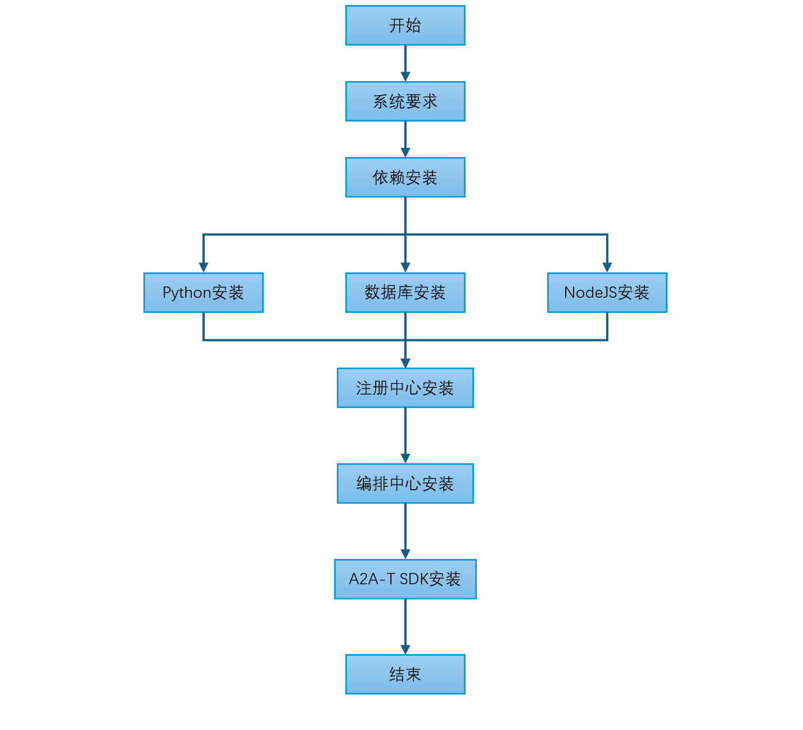
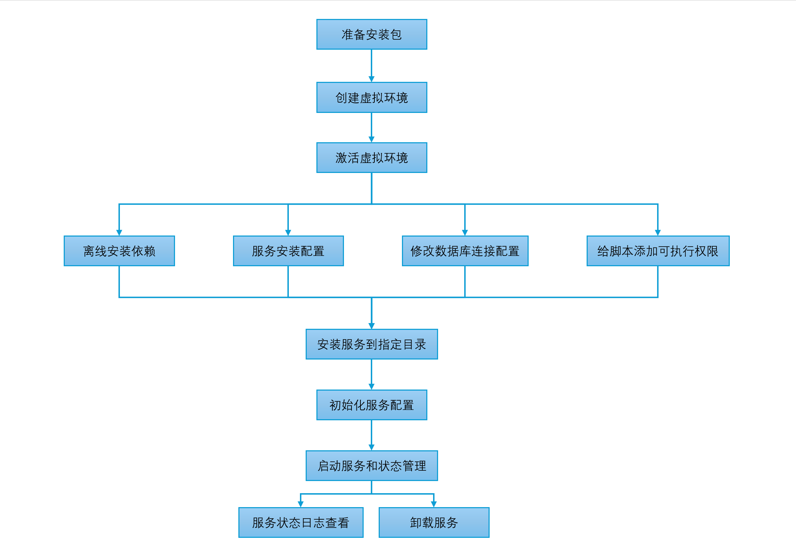

<!--
Copyright (c) 2026 Huawei Technologies Co., Ltd.
All Rights Reserved.

SPDX-License-Identifier: Apache-2.0

   Licensed under the Apache License, Version 2.0 (the "License"); you may
   not use this file except in compliance with the License. You may obtain
   a copy of the License at

        http://www.apache.org/licenses/LICENSE-2.0

   Unless required by applicable law or agreed to in writing, software
   distributed under the License is distributed on an "AS IS" BASIS, WITHOUT
   WARRANTIES OR CONDITIONS OF ANY KIND, either express or implied. See the
   License for the specific language governing permissions and limitations
   under the License.
-->
# OpenAN手动安装指导

[English](../en/manual-installation-guide.en.md) | 中文

> 本文逐步指导系统准备、依赖安装与各服务部署。采用[快速安装指导](quick-installation-guide.zh.md)的安装方式后可跳过本文对应步骤；本文适用于需要自定义systemd服务管理、外接已有数据库集群、或逐组件源码级部署的场景。本文面向负责部署与维护OpenAN系统的运维及开发人员。
## 一、系统要求

整体软件安装流程如下：



**图1：整体软件安装流程**

本项目基于Python 3.12开发，编译安装前请确保目标系统满足以下要求。

>  **组件说明：**<br />注册中心（Registry Center）是OpenAN的核心组件，负责Agent注册、发现与元数据管理；编排中心（Orchestration Center）负责工作流编排与任务调度。两者均需部署独立节点。

### 操作系统

| 操作系统 | 最低版本 |
|---------|---------|
| 其他 Linux 发行版 | 内核 3.10+ |
| CentOS / RHEL | 7.0+ |
| Ubuntu | 18.04+ |
| Debian | 10+ |

### 验证系统环境

```bash
# 检查 GCC 版本
gcc --version

# 检查 Make 版本
make --version

# 检查 Glibc 版本
ldd --version
```

| 工具 | 最低版本 | 推荐版本 | 查看命令 |
|-----|---------|---------|---------|
| GCC | 4.8.5 | 5.0+ | `gcc --version` |
| Make | 3.81 | 4.0+ | `make --version` |
| Glibc | 2.17 | 2.28+ | `ldd --version` |
>  **说明：**<br />Python 3.12编译需要支持C11标准的编译器，GCC 5.0+ 可提供更好的优化支持。Glibc 2.17是Python 3.12的最低要求，建议使用2.28+ 以获得更好的兼容性。

### 硬件部署建议资源
| 节点类型   | 主节点数量 | 从节点数量 | vCPU(个) | 内存(GB) | 硬盘        |
|--------|-------|-------|---------|--------|-----------|
| 注册中心节点 | 1     | 1     | 2       | 4      | 系统盘>=100G |
| 编排中心节点 | 1     | 1     | 2       | 4      | 系统盘>=100G |
| 数据库节点  | 1     | 1     | 2       | 4      | 系统盘>=100G |

### 最小部署建议资源
| 节点类型   | 主节点数量 | 从节点数量 | vCPU(个) | 内存(GB) | 硬盘       |
|--------|-------|-------|---------|--------|----------|
| 注册中心节点 | 1     | 0     | 1       | 2      | 系统盘>=50G |
| 编排中心节点 | 1     | 0     | 1       | 2      | 系统盘>=50G |
| 数据库节点  | 1     | 0     | 1       | 2      | 系统盘>=50G |

### 节点要求

在线环境要求节点可以连通外部网络；离线环境需提前在网络已连通的Linux机器（与目标服务器架构一致，x86_64或aarch64）上下载依赖包，再传输到目标节点安装（参见[注册中心服务安装步骤](#三注册中心服务安装步骤)和[编排中心服务安装步骤](#四编排中心服务安装步骤)第4步离线安装方案）。<br>
节点可以使用root用户登录。<br>
引导节点上需要安装tar工具。
>  **须知：**<br />建议您的节点环境足够干净，未安装任何Kubernetes组件，否则可能会发生版本冲突导致安装失败。

---

### 动手前自检清单

- [ ] 操作系统与内核满足[操作系统](#操作系统)表；GCC / Make / Glibc满足[工具版本要求](#验证系统环境)
- [ ] 硬件资源达到对应角色的[部署建议资源](#硬件部署建议资源)（或[最小部署建议资源](#最小部署建议资源)）
- [ ] 目标节点环境干净：未安装任何Kubernetes组件（仅集群安装要求）；tar工具可用
- [ ] 在线环境：节点可访问外网；离线环境：已在同架构联网机器准备好全部制品（依赖包 / 离线包 / bundle）
- [ ] 集群方式（容器化在线 / 容器化离线安装）：kubectl可用且具备管理员权限；离线方式另需每个节点containerd信任集群内私有仓库（见 [DEPENDENCIES §2.2](../../containerized/offline-install/docs/DEPENDENCIES.md)）

## 二、依赖安装

本项目基于Python 3.12开发，编译安装前请确保相关组件依赖满足以下要求：

| 组件       | 版本       | 说明       | 官网下载链接                                                     |
| ---------- | ---------- |----------| ---------------------------------------------------------------- |
| Python     | >= 3.12.11 | 项目开发语言   | https://www.python.org/ftp/python/3.12.11/Python-3.12.11.tgz     |
| PostgreSQL | >= 15.6    | 数据库存储服务  | https://ftp.postgresql.org/pub/source/v15.6/postgresql-15.6.tar.gz |
| NodeJS     | >= 20.19 | 编排中心前端依赖 | https://nodejs.org/dist/v22.19.0/node-v22.19.0-linux-x64.tar.xz   |

>  **说明：**<br />各组件离线安装指导如下，如果系统已有组件且版本已满足则可跳过此指导步骤。数据库此处以PostgreSQL为例，用户可根据实际场景选择数据库。

### 2.1 Python离线安装步骤

先检查环境上是否已安装python，版本是否为3.12.11，如果是则跳过如下安装步骤。

```bash
python3 --version   # 检查python版本
```

>  **判断标准：**<br />输出 `Python 3.12.11` 即满足要求，可跳过本节剩余步骤；若版本低于3.12.11或未安装，请继续执行以下安装步骤。

1. 下载安装包。

在可接通网络的Linux服务器上执行以下命令获取安装包，Windows系统则直接访问网页下载获取。

```bash
wget https://www.python.org/ftp/python/3.12.11/Python-3.12.11.tgz
```

将 `Python-3.12.11.tgz` 传输到目标服务器（如上传至 `/root` 目录），后续解压命令在 `/root` 目录下执行。

2. 解压安装包。

```bash
tar -xzf Python-3.12.11.tgz
cd Python-3.12.11
```

3. 配置安装路径。

```bash
# 安装到 /usr/local/python312，避免覆盖系统Python
./configure --prefix=/usr/local/python312 --enable-optimizations
```

4. 编译安装。

```bash
make -j 4
sudo make altinstall
```

>  **说明：**<br />编译耗时约10~20分钟，具体时间与机器性能有关；若编译失败，多因缺少依赖库，请先安装 `gcc-devel`、`openssl-devel`、`zlib-devel`、`bzip2-devel`、`libffi-devel` 等开发包后重试。

5. 创建软链接。

```bash
# 创建python3软链接
sudo ln -sf /usr/local/python312/bin/python3 /usr/local/bin/python3

# 创建pip3软链接
sudo ln -sf /usr/local/python312/bin/pip3 /usr/local/bin/pip3
```

6. 验证安装。

```bash
python3 --version   # 应输出 Python 3.12.11
pip3 --version
```

>  **判断标准：**<br />`python3 --version` 输出 `Python 3.12.11`、`pip3 --version` 输出版本号且路径指向 `/usr/local/python312/bin/` 即为安装成功；若输出其他版本或提示命令不存在，请检查软链接是否创建正确，或重新执行编译安装步骤。

**注意事项**

- 安装路径 `/usr/local/python312` 不影响系统自带Python。
- 软链接放在 `/usr/local/bin`，优先级低于 `/usr/bin`。
- 系统自带的 `python` 或 `python2` 命令保持不变。

### 2.2 数据库离线安装步骤
默认使用PostgreSQL数据库，用户可根据实际场景选择其他数据库，以下指导以PostgreSQL为例：

先检查环境上是否已安装PostgreSQL，版本是否为15.6，如果是则跳过如下安装步骤。

```bash
psql --version
```

>  **判断标准：**<br />输出 `psql (PostgreSQL) 15.6` 或更高版本即满足要求，可跳过本节剩余步骤；若版本低于15.6或未安装，请继续执行以下安装步骤。

1. 下载安装包。

在可接通网络的Linux服务器上执行以下命令获取安装包，Windows系统则直接访问网页下载获取。

```bash
wget https://ftp.postgresql.org/pub/source/v15.6/postgresql-15.6.tar.gz
```

将 `postgresql-15.6.tar.gz` 传输到目标服务器（如上传至 `/root` 目录），后续解压命令在 `/root` 目录下执行。

2. 解压安装包。

```bash
tar -xzf postgresql-15.6.tar.gz
cd postgresql-15.6
```

3. 配置安装路径。

```bash
# 安装到 /usr/local/pgsql
./configure --prefix=/usr/local/pgsql --without-readline
```

常用配置选项：
- `--prefix=/usr/local/pgsql`: 指定安装路径。
- `--with-openssl`: 启用SSL支持。
- `--with-readline`: 启用readline支持（默认启用）。
- `--with-zlib`: 启用zlib支持（默认启用）。

4. 编译安装。

```bash
make -j 4
sudo make install
```

>  **说明：**<br />编译耗时约10~20分钟，具体时间与机器性能有关；若编译失败，多因缺少依赖库，请先安装 `gcc-devel`、`openssl-devel`、`zlib-devel`、`readline-devel` 等开发包后重试。

5. 创建postgres用户。

```bash
sudo useradd postgres
```

6. 创建数据目录并授权。

```bash
sudo mkdir -p /usr/local/pgsql/data
sudo chown -R postgres:postgres /usr/local/pgsql/data
```

7. 初始化数据库。

```bash
su - postgres # 切换至postgres用户
/usr/local/pgsql/bin/initdb -D /usr/local/pgsql/data
```

8. 启动PostgreSQL服务。

```bash
# 切换至postgres用户
su - postgres

# 前台启动
/usr/local/pgsql/bin/pg_ctl -D /usr/local/pgsql/data -l /usr/local/pgsql/data/logfile start

# 添加系统环境变量
echo "export PATH=/usr/local/pgsql/bin:\$PATH" >> ~/.bashrc
source ~/.bashrc

# 确认启动成功
psql -l

# 检查版本
/usr/local/pgsql/bin/psql --version

# 连接数据库
/usr/local/pgsql/bin/psql -c "SELECT version();"
```

退出`postgres`用户可输入`exit`。

9. 配置systemd服务（可选）。

```bash
sudo tee /etc/systemd/system/postgresql.service << EOF
[Unit]
Description=PostgreSQL 15 Database Server
After=network.target

[Service]
Type=forking
User=postgres
Group=postgres
Environment=PGDATA=/usr/local/pgsql/data
ExecStart=/usr/local/pgsql/bin/pg_ctl start -D /usr/local/pgsql/data -l /usr/local/pgsql/data/logfile
ExecStop=/usr/local/pgsql/bin/pg_ctl stop -D /usr/local/pgsql/data
ExecReload=/usr/local/pgsql/bin/pg_ctl reload -D /usr/local/pgsql/data
PIDFile=/usr/local/pgsql/data/postmaster.pid
TimeoutSec=300

[Install]
WantedBy=multi-user.target
EOF

sudo systemctl daemon-reload
sudo systemctl enable postgresql
sudo systemctl start postgresql
```

10. 创建数据库和用户。

```bash
# 切换至postgres用户
su - postgres

# 进入sql交互界面
psql
```

在psql中执行：

```sql
CREATE USER registry_user WITH ENCRYPTED PASSWORD 'your_password' CREATEDB;
```

11. 配置远程访问（使用root用户）。

- 编辑 `/usr/local/pgsql/data/pg_hba.conf`，在末尾添加：

```bash
# 添加允许远程连接
host    all             all             0.0.0.0/0               scram-sha-256
```

- 编辑 `/usr/local/pgsql/data/postgresql.conf`：

```bash
# 修改监听地址
listen_addresses = '*'
```

- 重启服务：

```bash
# 使用systemctl重启（推荐）
sudo systemctl restart postgresql

# 或重启数据库配置
su - postgres -c "/usr/local/pgsql/bin/pg_ctl -D /usr/local/pgsql/data restart"
```

**注意事项**

- PostgreSQL默认使用端口5432。
- 生产环境请务必修改默认密码。
- 配置防火墙规则限制数据库访问。
- 建议定期备份数据库。

### 2.3 NodeJS离线安装步骤
先检查环境上是否已安装NodeJS，版本是否满足 ≥ 20.19；本文以v22.19.0为例，已满足则可跳过如下安装步骤。

```bash
node --version   # 应输出 v22.19.0
```

>  **判断标准：**<br />输出版本号 ≥ v20.19即满足要求，可跳过本节剩余步骤；若版本低于v20.19或未安装，请继续执行以下安装步骤。

1. 下载安装包。

NodeJS使用预编译二进制包，按目标服务器架构选择对应的包。在可接通网络的Linux服务器上执行以下命令获取安装包，Windows系统则直接访问网页下载获取。

x86_64架构：

```bash
wget https://nodejs.org/dist/v22.19.0/node-v22.19.0-linux-x64.tar.xz
```

aarch64架构：

```bash
wget https://nodejs.org/dist/v22.19.0/node-v22.19.0-linux-arm64.tar.xz
```

将下载的 `.tar.xz` 包传输到目标服务器（如上传至 `/root` 目录），后续解压命令在 `/root` 目录下执行。

2. 解压安装包。

根据下载的包名解压到 `/usr/local/` 目录：

```bash
# x86_64架构：
tar -xJf node-v22.19.0-linux-x64.tar.xz -C /usr/local/
mv /usr/local/node-v22.19.0-linux-x64 /usr/local/nodejs

# aarch64架构：
# tar -xJf node-v22.19.0-linux-arm64.tar.xz -C /usr/local/
# mv /usr/local/node-v22.19.0-linux-arm64 /usr/local/nodejs
```

3. 配置环境变量。

```bash
# 添加NodeJS到系统环境变量
echo "export PATH=/usr/local/nodejs/bin:\$PATH" >> ~/.bashrc
source ~/.bashrc
```

4. 验证安装。

```bash
node --version   # 应输出 v22.19.0
npm --version
```

>  **判断标准：**<br />`node --version` 输出版本号 ≥ v20.19、`npm --version` 输出版本号即安装成功；若提示命令不存在，请检查环境变量配置后重新打开终端或执行 `source ~/.bashrc`。

**注意事项**

- NodeJS使用预编译二进制包，无需编译工具链，**架构必须与目标服务器一致**（x86_64对应 `linux-x64`，aarch64对应 `linux-arm64`）。
- 默认安装路径为 `/usr/local/nodejs`。
- 生产环境建议使用nvm管理多个NodeJS版本。
- **说明**：NodeJS仅用于编排中心前端开发构建，生产环境中前端通过nginx加载静态资源，若仅在目标服务器上部署运行则无需安装NodeJS。

---

## 三、注册中心服务安装步骤


**图2：注册中心服务安装流程**

>  **执行说明：**<br />本章操作需使用root用户登录注册中心节点执行；前置条件为已完成 §二 依赖安装（Python 3.12、PostgreSQL数据库可用）。

1. 获取源码。

**在线环境**：

```bash
git clone https://github.com/project-openan/registry-center.git
cd registry-center
```

**离线环境**：在网络已连通的机器上clone源码后打包传输到目标服务器。

```bash
# 在网络已连通的机器上执行
git clone https://github.com/project-openan/registry-center.git
tar -czf registry-center.tar.gz registry-center/

# 将 registry-center.tar.gz 传输到目标服务器（如上传至 /root 目录）后解压
tar -xzf registry-center.tar.gz
cd registry-center
```

2. 创建虚拟环境。

```bash
# 使用已安装的Python 3.12创建虚拟环境
python3 -m venv venv --copies
```

3. 激活虚拟环境。

```bash
# 激活虚拟环境
source venv/bin/activate
```

激活后，命令行前缀会显示 `(venv)`。

4. 安装依赖。

**在线环境**：激活虚拟环境后直接安装依赖。

```bash
# 激活虚拟环境后安装依赖
pip install -r ./requirements.txt
```

>  **说明：**<br />pip安装耗时约1~5分钟，具体时间与网络情况有关；若安装失败，请检查网络连接、pip源是否可用，或尝试使用 `pip install -r ./requirements.txt -i <可用的 pip 源>` 指定其他源后重试。

**离线环境**：目标服务器无法连接外部网络，需在相同架构（x86_64或aarch64）的网络已连通的Linux机器上提前下载wheel包。
- 在网络已连通的机器上执行：

```bash
# 创建wheel存放目录
mkdir -p ./wheels

# 查看机器架构
uname -m   # x86_64 或 aarch64

# 下载所有依赖的wheel包（需Python 3.12环境，耗时约 2~10 分钟，具体时间与网络情况有关）
# x86_64架构：
pip download -r ./requirements.txt -d ./wheels \
  --platform manylinux2014_x86_64 \
  --python-version 3.12 \
  --only-binary=:all:

# aarch64架构：
# pip download -r ./requirements.txt -d ./wheels \
# --platform manylinux2014_aarch64 \
# --python-version 3.12 \
# --only-binary=:all:

# 打包wheel目录
tar -czf registry-center-wheels.tar.gz ./wheels
```

- 将 `requirements.txt` 和 `registry-center-wheels.tar.gz` 传输到目标服务器（如上传至 `/root/registry-center` 目录）后执行：

```bash
# 解压wheel包
tar -xzf registry-center-wheels.tar.gz

# 激活虚拟环境后离线安装
source venv/bin/activate
pip install --no-index --find-links=./wheels -r ./requirements.txt
```

>  **说明：**<br />`--platform manylinux2014` 确保下载的wheel包在glibc 2.17+的系统上均可运行，覆盖CentOS 7/Ubuntu 18.04及以上版本。`--only-binary=:all:` 仅下载预编译wheel，若部分包无manylinux wheel导致下载失败，可去掉该参数改为下载源码包（sdist），在目标服务器上编译安装（需GCC等编译工具）。

5. 服务安装配置（可选）。

可在`./etc/systemd/deploy.conf`文件中配置服务部署目录等。

```bash
vi ./etc/systemd/deploy.conf

# Registry Center 部署配置
# Copyright (c) 2026 Huawei Technologies Co., Ltd.

# 部署目录（服务安装位置）
INSTALL_DIR=/OpenA2A-T/registry-center

# Python路径（留空则用  INSTALL_DIR/venv/bin/python3）
PYTHON_PATH=

# 服务名称
SERVICE_NAME=registry-center

# 是否自动安装依赖（推荐设置为true，使用pip安装）
INSTALL_DEPS=true
```

> 退出vi：按下Esc按键，输入:wq!

6. 修改数据库连接配置。

修改注册中心配置文件： `./etc/conf/persistence.conf`

- 修改`postgresql.host`为数据库所在节点IP（即 §2.2中数据库节点的实际IP地址）

- 修改`postgresql.port`为postgresql数据库端口号，默认为`5432`

- 用户名`postgresql.username`、密码`postgresql.password`按照数据库实际设置的情况进行修改（即 §2.2步骤10中创建的数据库用户和密码）

关键字段说明：

| 字段 | 含义 | 默认值 | 取值说明 |
|------|------|--------|----------|
| `postgresql.host` | PostgreSQL 数据库节点 IP | `127.0.0.1` | 填写数据库节点实际 IP，本机部署填 `127.0.0.1` |
| `postgresql.port` | PostgreSQL 数据库监听端口 | `5432` | 与数据库实际监听端口一致 |
| `postgresql.username` | 数据库连接用户名 | `registry_user` | 需具备 CREATEDB 权限，对应 §2.2 步骤10创建的用户 |
| `postgresql.password` | 数据库连接密码 | - | 对应 §2.2 步骤10创建用户时设置的密码 |
| `persistence.mode` | 持久化存储模式 | `postgresql` | 可选 `postgresql` 或 `file`；生产环境推荐 `postgresql` |

7. 给脚本添加可执行权限。

```bash
# 给脚本添加可执行权限
chmod +x ./bin/*.sh
```

8. 安装服务到指定目录。

```bash
# 安装服务到上文[步骤5](#5服务安装配置可选)中指定的 INSTALL_DIR 目录
sudo ./bin/install_service.sh install

# 执行成功后将回显成功信息：
# Installing the project to /OpenA2A-T/registry-center...
# Files copied successfully
# Deploy Configuration:
# Install Dir: /OpenA2A-T/registry-center
# Python Path: /OpenA2A-T/registry-center/venv/bin/python3
# Install Deps: false
# 
# Using Python: /OpenA2A-T/registry-center/venv/bin/python3
# Python 3.12.11
# Service installed successfully!
```

9. 初始化服务配置。

```bash
# 进入服务安装目录
cd /OpenA2A-T/registry-center

# 初始化服务配置
./venv/bin/python3 -m agent_registry.init
```

服务支持HTTPS和AgentCard（Agent能力描述卡片，用于声明Agent的身份、能力与服务端点）签名及验签能力，**首次启动可选择关闭，后续按需执行本章「初始化服务配置」步骤进行HTTPS与签名配置**。

```bash
是否开启HTTPS enable_https (y/n, 默认: true): n
是否需要提供注册中心签名配置 registry.sign.enabled (y/n, 默认: true): n
是否开启验签能力 signature_validation_enabled (y/n, 默认: true): n

==================================================
持久化存储配置
==================================================

请选择存储模式 persistence.mode (file/postgresql, 默认: postgresql): file

配置已完成，已保存在 /OpenA2A-T/registry-center/etc/conf/server.conf
```

10. 启动服务和状态管理。

```bash
# 启动服务
systemctl start registry-center

# 查看服务状态
systemctl status registry-center

# 停止服务
systemctl stop registry-center
```

>  **判断标准：**<br />`systemctl start` 无报错返回即启动成功；`systemctl status` 显示 `active (running)` 为成功，显示 `failed` 或其他状态为失败。若启动失败，请使用 `journalctl -u registry-center` 查看错误日志排查；常见原因包括端口占用、配置文件错误、依赖缺失等，修复后重新执行 `systemctl start registry-center`。

11. 服务状态日志查看。

```bash
# 查看所有日志
journalctl -u registry-center

# 实时追踪日志
journalctl -u registry-center -f
```

>  **说明：**<br />服务启动失败时，优先使用 `journalctl -u registry-center` 查看错误日志定位原因。

12. 卸载服务。

```bash
# 从安装目录卸载服务
sudo ./bin/install_service.sh uninstall
```

---

## 四、编排中心服务安装步骤


**图3：编排中心服务安装流程**

>  **执行说明：**<br />本章操作需使用root用户登录编排中心节点执行；前置条件为已完成 §二 依赖安装（Python 3.12、PostgreSQL数据库可用）。

1. 获取源码。

**在线环境**：

```bash
git clone https://github.com/project-openan/orchestration-center.git
cd orchestration-center
```

**离线环境**：在网络已连通的机器上clone源码后打包传输到目标服务器。

```bash
# 在网络已连通的机器上执行
git clone https://github.com/project-openan/orchestration-center.git
tar -czf orchestration-center.tar.gz orchestration-center/

# 将 orchestration-center.tar.gz 传输到目标服务器（如上传至 /root 目录）后解压
tar -xzf orchestration-center.tar.gz
cd orchestration-center
```

2. 创建虚拟环境。

```bash
# 使用已安装的Python 3.12创建虚拟环境
python3 -m venv venv --copies
```

3. 激活虚拟环境。

```bash
# 激活虚拟环境
source venv/bin/activate
```

激活后，命令行前缀会显示 `(venv)`。

4. 安装依赖。

**在线环境**：激活虚拟环境后直接安装依赖。

```bash
# 激活虚拟环境后安装依赖
pip install -r ./requirements.txt
```

>  **说明：**<br />pip安装耗时约1~5分钟，具体时间与网络情况有关；若安装失败，请检查网络连接、pip源是否可用，或尝试使用 `pip install -r ./requirements.txt -i <可用的 pip 源>` 指定其他源后重试。

**离线环境**：目标服务器无法连接外部网络，需在相同架构（x86_64或aarch64）的网络已连通的Linux机器上提前下载wheel包。
- 在网络已连通的机器上执行：

```bash
# 创建wheel存放目录
mkdir -p ./wheels

# 查看机器架构
uname -m   # x86_64 或 aarch64

# 下载所有依赖的wheel包（需Python 3.12环境，耗时约 2~10 分钟，具体时间与网络情况有关）
# x86_64架构：
pip download -r ./requirements.txt -d ./wheels \
  --platform manylinux2014_x86_64 \
  --python-version 3.12 \
  --only-binary=:all:

# aarch64架构：
# pip download -r ./requirements.txt -d ./wheels \
# --platform manylinux2014_aarch64 \
# --python-version 3.12 \
# --only-binary=:all:

# 打包wheel目录
tar -czf orchestration-center-wheels.tar.gz ./wheels
```

- 将 `requirements.txt` 和 `orchestration-center-wheels.tar.gz` 传输到目标服务器（如上传至 `/root/orchestration-center` 目录）后执行：

```bash
# 解压wheel包
tar -xzf orchestration-center-wheels.tar.gz

# 激活虚拟环境后离线安装
source venv/bin/activate
pip install --no-index --find-links=./wheels -r ./requirements.txt
```

>  **说明：**<br />`--platform manylinux2014` 确保下载的wheel包在glibc 2.17+的系统上均可运行，覆盖CentOS 7/Ubuntu 18.04及以上版本。`--only-binary=:all:` 仅下载预编译wheel，若部分包无manylinux wheel导致下载失败，可去掉该参数改为下载源码包（sdist），在目标服务器上编译安装（需GCC等编译工具）。

5. 服务安装配置（可选）。

可在`./etc/systemd/deploy.conf`文件中配置服务部署目录等。

```bash
vi ./etc/systemd/deploy.conf

# Orchestration Center 部署配置
# Copyright (c) 2026 Huawei Technologies Co., Ltd.

# 部署目录（服务安装位置）
INSTALL_DIR=/OpenA2A-T/orchestration-center

# Python路径（留空则用  INSTALL_DIR/venv/bin/python3）
PYTHON_PATH=

# 服务名称
SERVICE_NAME=orchestration-center

# 是否自动安装依赖（推荐设置为true，使用pip安装）
INSTALL_DEPS=true
```

> 退出vi：按下Esc按键，输入:wq!

6. 修改数据库连接配置。

修改编排中心配置文件： `./etc/conf/db_config.json`

- 修改`host`为PostgreSQL数据库所在节点IP（即 §2.2中数据库节点的实际IP地址）

- 修改`port`为PostgreSQL数据库端口号，默认为`5432`

- 用户名`user`密码、`password`按照数据库实际设置的情况进行修改（即 §2.2步骤10中创建的数据库用户和密码）

关键字段说明：

| 字段 | 含义 | 默认值 | 取值说明 |
|------|------|--------|----------|
| `host` | PostgreSQL 数据库节点 IP | `127.0.0.1` | 填写数据库节点实际 IP，本机部署填 `127.0.0.1` |
| `port` | PostgreSQL 数据库监听端口 | `5432` | 与数据库实际监听端口一致 |
| `user` | 数据库连接用户名 | `registry_user` | 需具备 CREATEDB 权限，对应 §2.2 步骤10创建的用户 |
| `password` | 数据库连接密码 | - | 对应 §2.2 步骤10创建用户时设置的密码 |
| `database` | 数据库名称 | `registry_center` | 编排中心使用的数据库名，需提前创建 |

7. 给脚本添加可执行权限。

```bash
# 给脚本添加可执行权限
chmod +x ./bin/*.sh
```

8. 安装服务到指定目录。

```bash
# 安装服务到上文[步骤5](#5服务安装配置可选)中指定的 INSTALL_DIR 目录
sudo ./bin/install_service.sh install

# 执行成功后将回显成功信息：
# Installing the project to /OpenA2A-T/orchestration-center...
# Files copied successfully
# Deploy Configuration:
# Install Dir: /OpenA2A-T/orchestration-center
# Python Path: /OpenA2A-T/orchestration-center/venv/bin/python3
# Install Deps: false
# 
# Using Python: /OpenA2A-T/orchestration-center/venv/bin/python3
# Python 3.12.11
# Service installed successfully!
```

9. 初始化服务配置（需配置数据库）。

```bash
# 进入服务安装目录
cd /OpenA2A-T/orchestration-center

# 初始化服务配置，可配置服务端口，是否启用HTTPS等
vi ./etc/conf/server.conf
```

关键字段说明：

| 字段 | 含义 | 默认值 | 取值说明 |
|------|------|--------|----------|
| `server.port` | 服务监听端口 | `5001` | 与 nginx 配置中的 `upstream` 后端端口保持一致 |
| `enable_https` | 是否启用 HTTPS | `false` | `true` / `false`；当前能力开发中，默认关闭 |
| `ssl.certfile` | SSL 证书文件路径 | - | 启用 HTTPS 时必填，指向 PEM 格式证书文件 |
| `ssl.keyfile` | SSL 私钥文件路径 | - | 启用 HTTPS 时必填，指向 PEM 格式私钥文件 |

HTTPS能力开发中，默认关闭。如需启用，请将 `enable_https` 改为 `true`，并确保已配置SSL证书后重启服务。

```bash
# 设置enable_https=false
:wq!
```

10. 启动服务和状态管理。

```bash
# 启动服务
systemctl start orchestration-center

# 查看服务状态
systemctl status orchestration-center

# 停止服务
systemctl stop orchestration-center
```

>  **判断标准：**<br />`systemctl start` 无报错返回即启动成功；`systemctl status` 显示 `active (running)` 为成功，显示 `failed` 或其他状态为失败。若启动失败，请使用 `journalctl -u orchestration-center` 查看错误日志排查；常见原因包括端口占用、配置文件错误、依赖缺失等，修复后重新执行 `systemctl start orchestration-center`。

11. 服务状态日志查看。

```bash
# 查看所有日志
journalctl -u orchestration-center

# 实时追踪日志
journalctl -u orchestration-center -f
```

>  **说明：**<br />服务启动失败时，优先使用 `journalctl -u orchestration-center` 查看错误日志定位原因。

12. 卸载服务。

```bash
# 从安装目录卸载服务
sudo ./bin/install_service.sh uninstall
```

---

## 五、编排中心前端部署步骤

编排中心前端为React单页应用，源码已集成在编排中心代码仓中。完成[编排中心服务安装步骤](#四编排中心服务安装步骤)后前端代码即已安装完成。

>  **注意：**<br />纯离线目标节点无法访问npm registry，**绝不能**在目标节点执行 `npm install`；前端静态资源必须在有外网的构建机上预先构建打包（见下文生产模式），传输到离线节点后由nginx托管。

**开发模式**（需NodeJS，用于调试）：

```bash
cd {安装目录}/orchestration-center/workflow-designer
npm install --force
npm run dev
```

启动成功后通过 `http://localhost:3003` 访问。

**生产模式**（推荐，无需NodeJS）：构建静态资源后通过nginx托管。
- 在有NodeJS的开发机上构建：

```bash
cd orchestration-center/workflow-designer
npm install --force
npm run build      # 产出 dist/ 目录
tar -czf workflow-designer-dist.tar.gz dist/
```

- 将 `workflow-designer-dist.tar.gz` 传输到目标服务器（如上传至 `/root` 目录），解压到编排中心安装目录后配置nginx。以下为完整的nginx参考配置，用户可根据实际部署环境修改标注了 `<-- 可按需修改` 的配置项：

```nginx
user nginx                              # <-- 按实际运行用户修改
worker_processes  1;                    # <-- 可按CPU核数调整
events {
    worker_connections  1024;           # <-- 可按需调整
}

http {
    include       mime.types;
    default_type  application/octet-stream;
    sendfile        on;
    keepalive_timeout  65;

    # 编排中心后端集群，按实际后端服务地址修改
    upstream orchestrate_backend {
        server 127.0.0.1:5001 max_fails=3 fail_timeout=30s;  # <-- 改为实际后端IP:端口，可添加多个节点
    }

    server {
        listen       80;                # <-- 可按需修改监听端口
        server_name  localhost;         # <-- 按实际域名或IP修改

        # 前端静态资源
        location / {
            root   /path/to/orchestration-center/dist;  # <-- 改为实际dist目录路径
            index  index.html index.htm;
            try_files $uri $uri/ /index.html;                 # SPA路由支持
        }

        # 编排中心 API 反向代理
        location /api/orchestrate/ {
            proxy_pass http://orchestrate_backend/;
            proxy_set_header Host $host;
            proxy_set_header X-Real-IP $remote_addr;
            proxy_set_header X-Forwarded-For $proxy_add_x_forwarded_for;
            proxy_set_header X-Forwarded-Proto $scheme;

            proxy_connect_timeout 5s;    # <-- 可按需调整
            proxy_send_timeout 180s;     # <-- 可按需调整
            proxy_read_timeout 180s;     # <-- 可按需调整
            proxy_next_upstream error timeout http_500 http_502 http_503;
        }
    }
}
```

>  **配置说明：**<br />上述配置中 `root /path/to/orchestration-center/dist` 需替换为实际的dist目录路径。`upstream` 中的 `127.0.0.1:5001` 需替换为实际的编排中心后端服务地址（本地部署用 `127.0.0.1`，远程部署用内网IP）。其余选项（端口、超时等）按实际网络环境和需求调整即可。

>  **说明：**<br />生产环境推荐构建模式，目标服务器无需安装NodeJS。

---

## 六、A2A-T SDK离线安装步骤

A2A-T SDK分为a2a-t-sdk-python和a2a-t-sdk-java两种，是A2A-T协议的Python/Java实现。A2A-T是OpenAN生态中面向Agent间通信与任务协商的开放协议，定义了Agent发现、提示词生成、校验与多轮协商的标准交互流程。a2a-t-sdk-python面向客户端Agent和服务端Agent提供任务提示词生成、提示词校验和多轮协商能力。a2a-t-sdk-java面向Java Agent提供客户端提示词生成、服务端提示词校验、协商运行时和A2A Java集成样例。

- a2a-t-sdk-python

[安装和配置方式见Python SDK的用户指南](https://github.com/project-openan/a2a-t-sdk-python/blob/main/docs/zh/%E7%94%A8%E6%88%B7%E6%8C%87%E5%8D%97.md)

Python SDK源码位于 `a2a-t-sdk-python` 仓库，端到端演示样例位于 `a2a-t-samples` 仓库。SDK运行前需准备Python 3.12+，并配置可用的LLM服务地址和API Key。

- a2a-t-sdk-java

[安装和配置方式见Java SDK的用户指南](https://github.com/project-openan/a2a-t-sdk-java/blob/main/docs/zh/%E7%94%A8%E6%88%B7%E6%8C%87%E5%8D%97.md)

Java SDK源码和示例均位于 `a2a-t-sdk-java` 仓库。运行前需准备JDK 17+、Maven，并配置可用的LLM服务地址和API Key。

---

