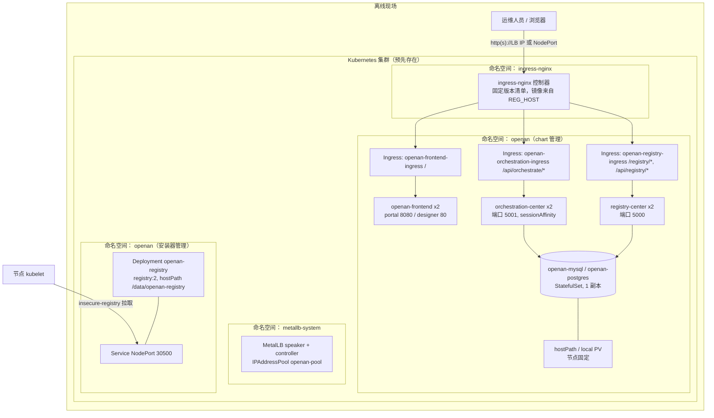
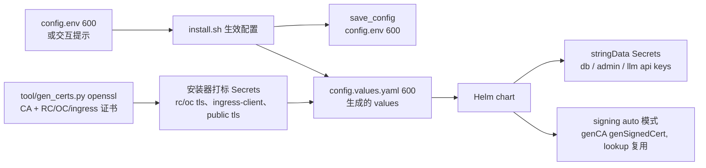
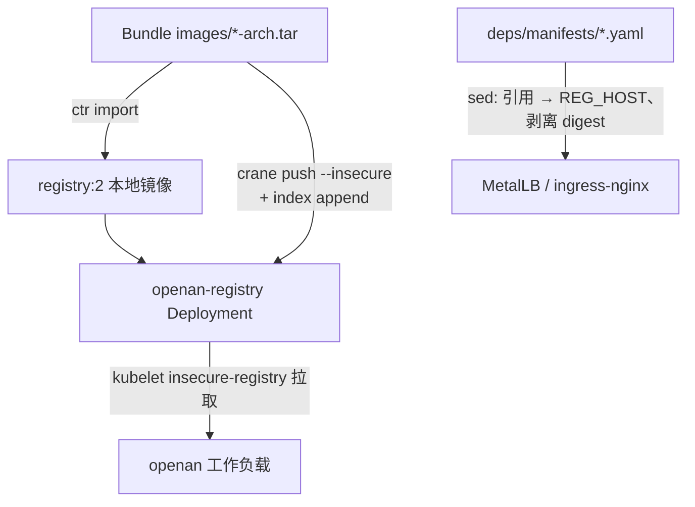
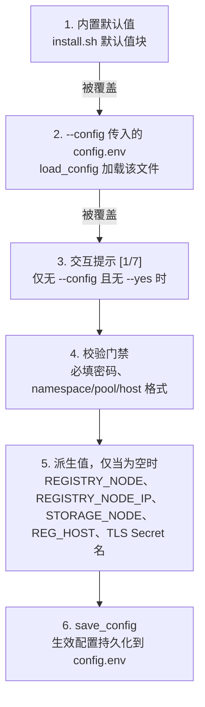

# 离线Kubernetes安装架构设计

[English](offline-install-architecture.en.md) | 中文

## 1. 概述

`containerized/offline-install/` 交付件将OpenAN平台部署到**目标现场既有的、无外网（air-gapped）的Kubernetes集群**上，安装介质为传输到现场的自包含bundle。它由3个协作部分组成：

| 组成部分 | 产物 | 职责 |
|------|----------|------|
| Helm chart | `chart/` | OpenAN 工作负载的声明式资源定义 |
| 安装器 | `scripts/install.sh`（含 `check-env.sh`、`push-images.sh`、`lib/common.sh`） | 编排配置、集群内镜像仓库、基础设施插件与 `helm upgrade --install` |
| Bundle | 由 `build/build-offline.sh` 产出 | 按架构分离的镜像 tar、固定版本二进制（helm/kubectl/crane）、固定版本基础设施清单、chart、脚本、`SHA256SUMS` |

安装器**全程不使用互联网，也不修改操作系统或容器运行时配置**（`scripts/install.sh:9`）。镜像通过集群内 `registry:2` 分发，由bundle自带的 [crane](https://github.com/google/go-containerregistry) 以明文HTTP推送。

### 范围

- 目标：一个可运行的kubeadm风格集群（按 `chart/Chart.yaml` 的 `kubeVersion` 要求v1.33+），安装节点可通过 `kubectl` 访问，且对节点containerd有 `ctr` 权限。
- 在MetalLB与ingress-nginx缺失时，从 **bundle内固定版本清单**安装二者。
- 首次运行支持交互（提示输入、密钥掩码），也可通过 `config.env` 全配置驱动重跑；对已存在的release重跑即**原地升级**（`helm upgrade --install`，保留版本历史可供 `helm rollback`）。

### 非目标

- 集群创建（参考 [docs/KUBEADM_CLUSTER.md](../../containerized/offline-install/docs/KUBEADM_CLUSTER.md) 中仅作参考的离线kubeadm构建方案）。
- 明文HTTP镜像仓库的containerd信任配置 —— 这是逐节点的手工前置条件（`docs/DEPENDENCIES.md` §2.2）；安装器只对本地节点做**探测**。
- 零停机滚动语义：chart的Deployment使用 `Recreate`，升级期间会短暂停服（见部署契约）。
- 在线/交互安装线与Compose安装线（见 [online-install-architecture.zh.md](online-install-architecture.zh.md) 与 [offline-install-compose-architecture.zh.md](offline-install-compose-architecture.zh.md)）。

---

## 2. 架构

### 2.1 部署拓扑



`openan` 命名空间内并存两个权属域：chart管理的工作负载，以及**安装器管理的私有镜像仓库**（Deployment + NodePort Service，由 `install.sh:348-409` 直接写入，在Helm chart之外；由 `uninstall.sh:95-99` 移除）。架构视角不能假设命名空间内的一切都属于该Helm release。

### 2.2 组件清单

| 资源 | 类型 | 名称 | 说明 |
|----------|------|------|-------|
| 私有镜像仓库 | Deployment | `openan-registry` | 安装器所有；`imagePullPolicy: Never`，节点固定，hostPath `/data/openan-registry` |
| 私有镜像仓库 | Service | `openan-registry` | NodePort `30500`（`REGISTRY_NODEPORT`） |
| 注册中心（RC） | Deployment | `registry-center` | 2 副本（安装器强制），preferred antiAffinity |
| 编排中心（OC） | Deployment | `orchestration-center` | 1 副本（chart 与安装器均固定，进程内会话态）；`seed-etc` init 容器；Service `sessionAffinity: ClientIP`（43200s） |
| 前端 | Deployment | `openan-frontend` | portal（8080，环境变量驱动）或 workflow-designer（80，chart 管理 nginx，经 render init 容器） |
| 前端 | Service | `openan-frontend` | NodePort 30191 |
| 数据库 | StatefulSet | `openan-mysql` / `openan-postgres` | 硬编码 1 副本；init ConfigMap 创建两个应用库与用户 |
| 数据库 PV | PV | `openan-mysql-pv` / `openan-postgres-pv` | 可选，节点固定，Retain |
| Ingress | Ingress | `openan-{frontend,orchestration,registry}-ingress` | 与在线 chart 相同的路径契约 |
| MetalLB 配置 | CR | `openan-pool` / `openan-l2` | 来自 `METALLB_POOL`；由安装器应用 |

### 2.3 外部依赖

| 依赖 | 来源 | 说明 |
|------------|--------|-------|
| helm / kubectl / crane | bundle 内 `deps/bin/` | 固定版本（helm v3.19.5、kubectl v1.34.12、crane v0.19.2）；bundle 内二进制优先于 PATH（`install.sh:124-141`） |
| ingress-nginx / MetalLB | `deps/manifests/` | 固定版本（controller-v1.15.1、v0.16.1）；镜像引用经 sed 改写为 `REG_HOST`，digest 被剥离（`install.sh:446-448, 487-489`） |
| containerd 信任 | 逐节点手工配置 | `certs.d/<ip>:30500/hosts.toml` + 重启；check-env 仅对本地节点告警 |
| 存储 | 集群或安装器 | 默认 StorageClass，或节点固定的 hostPath PV（见 §3.4） |
| LLM | 内部端点 | 仅在 `LLM_VALIDATE=true` 时探测（离线默认关闭） |

---

## 3. 组件设计

### 3.1 安装器流程（7个阶段）


- **配置**（`install.sh:146-193`）：仅当未指定 `--config` 且未加 `--yes` 时进入交互提示；密钥经 `/dev/tty` 掩码读取（`common.sh:88-112`）。`OC_ADMIN_PASSWORD` 是硬性门禁 —— OC在HTTP模式下没有凭证会拒绝启动（`install.sh:195-199`）。
- **check-env**（`check-env.sh`，332行）：只读探测器 —— bundle校验和、工具链、集群、混合架构节点、存储模式、ingress、MetalLB地址池、containerd信任、按架构镜像tar、NTP/磁盘；可选LLM探测。`--soft` 模式永不以非零退出。
- **确认 + 持久化**：生效配置回写 `config.env`（`config.env.example` 的37个键加save_config另回写的 `K8S_NAMESPACE`、`PUBLIC_TLS_SECRET`，共39个键，chmod 600），使重跑免交互。
- **私有镜像仓库**：唯一直接导入containerd的镜像（`ctr -n k8s.io images import`，`install.sh:335-343`）；registry自身以该本地镜像运行，`imagePullPolicy: Never`。
- **推送镜像**：`push-images.sh` 使用crane —— 单架构tar直接推送到最终tag；多架构tar推送到 `<tag>-<arch>` 副tag，再用 `crane index append --insecure` 拼装manifest list（`push-images.sh:93-107`）。crane走明文HTTP，无需Docker守护进程。
- **Helm upgrade --install**：生成 `config.values.yaml`（chmod 600）；release已存在时**原地升级** —— 复用既有基础设施与Secret、保留版本历史（`helm rollback` 可回退）。已渲染清单与部署values随时可用 `helm get manifest` / `helm get values` 取回。
- **验证**：所有Pod Running（60×5s）、registry catalog、可选示例智能体服务（`START_AGENTS_SERVER` → `kubectl exec` nohup启动 `samples/start_agents_server.py`，尽力而为），以及3条公开路径的HTTP smoke测试。

### 3.2 注册中心 / 编排中心（Deployment）

与在线chart的关键差异：

- **2副本 + preferred podAntiAffinity**（安装器将RC、前端的 `replicas` 设为2），OC固定单副本（进程内会话态、文件型运行时状态不可跨副本共享），故以Service `sessionAffinity` 兜底。OC会话为进程内态，因此Service设置 `sessionAffinity: ClientIP`（12小时超时）——否则跨副本请求会401（`orchestration-center/service.yaml:15-23`）。
- **OC `seed-etc` init容器**将镜像内只读 `etc/` 拷贝到emptyDir，并从模板渲染 `db_config.json` —— 镜像内etc/ 运行期不可写（`orchestration-center/deployment.yaml:33-53`）。
- **OC探针为tcpSocket :5001** —— 不存在免鉴权的HTTP端点（无会话时所有路由返回401）。RC探针为httpGet agent-cards路径，协议跟随 `https.enabled`。
- **前端**：portal从环境变量自渲染nginx配置（`BACKEND_URL`/`REGISTRY_URL`）；workflow-designer使用 `render-nginx-config` init容器（envsubst/sed写入emptyDir），避免只读ConfigMap挂载导致入口崩溃。

### 3.3 私有镜像仓库（安装器管理）

`registry:2` 固定于bundle内，NodePort `30500`，hostPath `/data/openan-registry`（`DirectoryOrCreate`），固定调度到 `REGISTRY_NODE`。所有工作负载镜像引用在安装时改写为 `${REG_HOST}/<repo>:<tag>`（`install.sh:654-765`）—— config.env只携带registry相对引用。`INSTALL_REGISTRY=false` 表示使用同主机上的外部registry，跳过部署与推送。

### 3.4 数据库与存储

一个 `database.type` 贯穿所有层（issue #36）：

- **内置后端** —— `postgresql` 与 `mysql` 列在chart的 `database.backends` 描述表里（数据而非代码）：镜像、端口、密码env/key、探针、卷与PV默认值均来自描述项。一对通用模板（`database/statefulset.yaml` + `database/storage.yaml`）按 `database.type` 渲染对应条目；仅初始化ConfigMap（`database/init/<type>.yaml`）按后端各一份，因为引导SQL方言不同。工作负载名、标签、env、探针与PV名与历史per-type模板完全一致，release升级时selector兼容。
- **外部后端** —— 任何其他非空小写类型（如 `gauss`）**不渲染数据库工作负载与存储**：类型原样透传给服务（`PERSISTENCE_MODE` 直通），配通用 `DB_HOST/DB_PORT/DB_NAME/DB_USERNAME` env；凭证经 `database.existingSecret` 按 `database.passwordKey` 读取。安装器对外部类型强制 `DB_HOST` + `DB_PORT`（`config.env`）；服务侧必须支持该mode（registry-center：file、sqlite、postgresql、gauss、mysql；orchestration-center 当前：file、postgresql、mysql）。
- **MySQL 8.4.3是本线默认**（`DB_TYPE=mysql`）；PostgreSQL 15仍可选择。chart自身默认保持 `postgresql`；安装器总是显式输出 `database.type`（+ 集群内镜像源的backend镜像覆盖，外部类型则输出 host/port）。
- 内置后端均为单副本StatefulSet，使用utf8mb4（mysql参数）与init脚本创建 `registry_center`/`registry` 与 `orchestration_center`/`opena2a_t`。
- **存储模式**（`STORAGE_MODE`）：`auto`（有默认StorageClass则用之，否则hostPath回退）、`sc`（显式 `STORAGE_CLASS`）、`hostpath`。回退路径创建 `openan-local` StorageClass与**节点固定** PV（`database/storage.yaml`，PV名来自backend描述项），保证多节点集群不会把数据库调度到数据所在节点之外。
- MySQL模式保留自身默认hostPath（`/data/openan-mysql`，来自描述项；安装器保留历史的HOSTPATH切换逻辑）。

### 3.5 校验

chart通过 `_helpers.tpl` 的 `fail()`（外部类型缺host/port、backend描述项缺字段）加上 `database/validate.yaml` 校验——内置白名单取自 `database.backends` 的键：`postgers` 这类拼写错误在渲染期即报错并列出有效的内置类型名，而不是运行期CrashLoop。check-env/install另有shell侧门禁（外部类型要求 `DB_HOST`/`DB_PORT`；内置类型检查镜像tar）。

---

## 4. 数据流

### 4.1 请求流

与在线线一致的路径契约：`/` → 前端，`/api/orchestrate(/|$)(.*)` → OC（rewrite `/$2`），`/registry` + `/api/registry` → RC。`backend-protocol: HTTPS` 注解跟随 `https.enabled`（默认开启）；设置了 `ingress.backendVerifyServer` 时还启用后端证书校验（`proxy-ssl-verify` + 按服务SNI）；ingress TLS块要求 `ingress.tls.enabled` 且配置DNS域名。

### 4.2 配置流



本线中Secrets按设计落盘（对比：在线向导将密钥保留在内存并经 `kubectl stdin` 传入）。所有生成物chmod 600且被gitignore（`config.env`、`config.values.yaml`）。

### 4.3 镜像流



---

## 5. 配置契约

### 5.1 config.env（37个键，安装器save_config另回写K8S_NAMESPACE、PUBLIC_TLS_SECRET两键）

分组汇总（权威清单见 [config.env.example](../../containerized/offline-install/config.env.example)）：

| 分组 | 键 |
|-------|------|
| 目标 | `K8S_NAMESPACE`（save_config 回写，不在 example 中） |
| 私有镜像仓库 | `INSTALL_REGISTRY`、`REGISTRY_NODE`、`REGISTRY_NODE_IP`、`REGISTRY_NODEPORT` |
| 基础设施插件 | `INSTALL_METALLB`、`METALLB_POOL`、`INGRESS_HOST` |
| 前端 | `FRONTEND_TYPE`（默认 `portal`） |
| 访问控制 | `OC_ADMIN_PASSWORD`（必填） |
| 传输安全 | `HTTPS_ENABLED`（默认 true）、`HTTPS_VERIFY_CLIENT`、`RC_TLS_SECRET`、`OC_TLS_SECRET`、`INGRESS_CLIENT_SECRET`、`REGISTRY_CLIENT_SECRET`（可选 OC→RC）、`PUBLIC_TLS_SECRET`（save_config 回写，不在 example 中） |
| 存储 | `STORAGE_MODE`、`STORAGE_CLASS`、`STORAGE_SIZE`、`HOSTPATH`、`STORAGE_NODE` |
| 数据库 | `DB_TYPE`、`DB_PASSWORD`（必填，8+ 字符）；外部类型另需 `DB_HOST`/`DB_PORT` |
| 镜像 | `REGISTRY_CENTER_IMAGE`、`ORCHESTRATION_CENTER_IMAGE`、`WORKFLOW_DESIGNER_IMAGE`、`PORTAL_IMAGE`、`POSTGRES_IMAGE`、`MYSQL_IMAGE`（registry 相对引用） |
| LLM | `REGISTRY_CHAT_{MODEL,URL,APIKEY}`、`ORCH_CHAT_{MODEL,URL,APIKEY}`、`LLM_VALIDATE` |
| 其他 | `REGISTRY_SIGNATURE_VALIDATION_ENABLED`（false —— 明文 HTTP 拓扑下卡片不签名）、`START_AGENTS_SERVER` |

### 5.2 参数解析与覆盖顺序

参数在**两个相互独立的层**中解析，彼此之间无交互。

**第1层 —— 安装器**（`install.sh`，后者优先级最高）：



- 交互答案优于 `config.env`，`config.env` 优于内置默认值。
- 模式开关：`--config <file>` 使该文件成为唯一来源（跳过提示）；`--yes` 跳过提示并自动确认所有问题；两者都不带则运行交互向导。
- 环境变量**不参与**：默认值块为每个键赋值，会覆盖shell中export的任何值。密钥只能经 `config.env` 或掩码交互提示进入。
- 生效值export给 `check-env.sh`（它自身优先取export的环境变量，其次自己的默认值，若给了 `--config` 则再读该文件）。

**第2层 —— 服务容器内部**（上游契约，后者优先级最高）：

```text
server.conf  ->  server.properties  ->  REGISTRY_* / ORCH_* 环境变量
```

重复键告警；后加载的来源获胜。本部署中环境来自chart ConfigMap（由生成的values渲染）加经 `secretKeyRef`/`envFrom` 消费的Secret，因此链条实际上是：**安装器配置 → 生成的values → ConfigMap环境变量 → 覆盖镜像内置 `server.conf`/`server.properties` 默认值**。独立的 `.env` 文件不会挂载进容器（且上游本就环境变量优先于它）。

### 5.3 Secret引用模型

安装器生成的values只引用Secret（`openan-db-credentials`、`openan-admin`、`openan-llm-keys` 及 §5.4的TLS系列）—— 任何密钥都不内联。chart自身保留每个凭证的直接Helm逃生口（`database.existingSecret` + `database.passwordKey`、`*.llm.*.existingSecret`、`orchestration.admin.existingSecret`、`registry.tls/signing.existingSecret`、`orchestration.tls.existingSecret`），并为不使用安装器的运维者提供从明文values渲染 `stringData` 的能力。models.yaml ConfigMap只引用环境变量名（`api_key_env`）—— 密钥永不内联。

### 5.4 PKI

bundle内不带任何证书。**HTTPS为默认开启**（`HTTPS_ENABLED` 默认 `true`）：安装器用 `tool/gen_certs.py`（openssl CLI —— 在线线的工具内置registry-center代码且依赖cryptography库，离线机器两者皆无；本移植保持相同输出契约）生成自签CA与各服务证书，并存为安装器打标的Secrets：

| Secret | 内容 | 使用方 |
|--------|----------|---------|
| `openan-rc-tls` | `server.cer`、`server_key.pem`、`trust.cer`、`cert_pwd` | RC `tls-certs` 卷（`mode=secret`） |
| `openan-oc-tls` | 同上 | OC `tls-certs` 卷（`mode=secret`） |
| `openan-ingress-client` | `tls.crt`、`tls.key`、`ca.crt` | ingress `proxy-ssl-verify`（+ mTLS 客户端材料） |
| `openan-registry-client` | `trust.cer`、`client.cer`、`client_key.pem` | OC→RC 出站校验（`clientVerifyServer`） |
| `openan-public-tls`（设置 `INGRESS_HOST` 时） | `tls.crt`、`tls.key` | 公网 ingress TLS 终结 |

ingress **总是校验后端服务器证书**（针对共享CA，`proxy-ssl-verify: on` + `proxy-ssl-secret`，SNI按服务固定），OC在其出站连接上校验registry的服务器证书（`orchestration.clientVerifyServer` + `registryClientSecret`）。支持运维者预建Secret并同时设置 `RC_TLS_SECRET` / `OC_TLS_SECRET` / `INGRESS_CLIENT_SECRET`（`REGISTRY_CLIENT_SECRET` 可选）来提供自有证书。JWS签名材料保持chart的 `auto` 模式（Helm `genCA`/`genSignedCert`，3650天，`lookup` 复用）。一个接口契约：`REGISTRY_JWK_PRIVATE_KEY_PASSWORD` 在auto模式下设为 `""`，因为空的 `cert_pwd` *文件* 会读成 `b''` 导致签名器崩溃。`HTTPS_VERIFY_CLIENT`（registry mTLS）保持可选 —— kubelet httpGet探针不提供客户端证书。

---

## 6. 安全

| 控制项 | 实现 |
|---------|----------------|
| 密钥输入 | 交互时从 `/dev/tty` 逐字符掩码读取 |
| 密钥静态存储 | `config.env`（创建时 umask 077）；生成的 values 文件**仅含引用**；安装器创建的 Secrets 带 `openan-offline-installer` 标签便于卸载清理 |
| 必填凭证 | `OC_ADMIN_PASSWORD` 与 `DB_PASSWORD`（8+ 字符、无默认值）为硬性门禁；输入校验含 namespace（DNS 标签）、MetalLB 地址池格式与 INGRESS_HOST（仅 DNS 名） |
| Shell 加固 | `set -euo pipefail`；所有尽力而为的探测都带 `|| true` 保护，使失败显式暴露而非被吞掉 |
| registry 传输 | 因离线环境所限使用明文 HTTP；信任是文档化的逐节点 containerd 前置条件 |
| 集群内服务 TLS | 默认开启：`tool/gen_certs.py`（openssl）→ 安装器打标 Secrets；ingress 校验后端（`proxy-ssl-verify`）；支持运维者自有 Secret |
| 管理员引导 | `OC_ADMIN_PASSWORD` 为门禁必填；为 OC 播种 `admin` 账号 |
| 令牌身份 | RC 默认 `token` 模式，凭证为 `static_bearer` |
| bundle 完整性 | 对每个 bundle 文件生成 `SHA256SUMS`；check-env 在校验和不匹配时告警（warn）提示 bundle 可能损坏/不完整（检测损坏，不检测真伪） |
| 卸载安全 | 每次删除都有 `--timeout` 边界；PV 按 `claimRef.namespace` 匹配而非名称；hostPath 数据永不触碰（打印手工 `rm -rf /data/openan-*` 提示） |

>  **说明：**<br />坦率说明：`load_config` **把config.env作为shell文件source**（`common.sh:144-145`）。本线没有“无shell求值”保证 —— 恶意的config.env会以安装器用户身份执行。缓解措施：该文件由运维者所有、chmod 600，且从不随bundle传输。（Compose线将同名文件按字面数据解析；见其架构文档。）

---

## 7. 可扩展性

- **新增chart values**：遵循 [chart/README.md](../../containerized/offline-install/chart/README.md)（完整参数表与权威ASCII图）；安装器生成的 `config.values.yaml` 是新config.env键的接线点。
- **新增bundle镜像**：扩展 `build/build-offline.sh` 中的 `deps/infra-images.list` 以及check-env/push-images/install中的循环。
- **专用ingress控制器**：已有控制器的集群可手工应用 `docs/ingress-nginx-openan.yaml`（IngressClass `openan-nginx`）—— 这是文档化的手工替代方案，不属于自动化流程。
- **测试**：本线目前没有专用pytest模块（在线chart与Compose线承担自动化契约）；`check-env.sh --soft` 加对生成values做一次 `helm template` 干跑是实用的预检。
