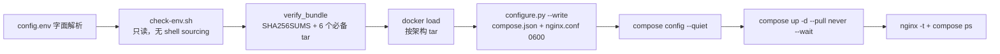

# 离线Compose安装架构设计

[English](../en/offline-install-compose-architecture.en.md) | 中文

## 1. 概述

`containerized/offline-install-compose/` 交付件将OpenAN平台部署到**单台无外网（air-gapped）的Docker主机**上 —— 完全不依赖Kubernetes —— 安装介质为自包含bundle。它由两个协作部分组成：

| 组成部分 | 产物 | 职责 |
|------|----------|------|
| 组合根（composition root） | `scripts/configure.py` | 校验输入并产出 `runtime/compose.json` + `runtime/nginx.conf`（仅标准库，无 shell 求值） |
| 安装器 | `scripts/install.sh`（含 `check-env.sh`、`uninstall.sh`、`lib/common.sh`） | 加载镜像、运行 configure、`docker compose up --wait` |

生成的Compose JSON是**唯一的部署产物** —— 本线任何地方都不存在手工维护的YAML或nginx契约（`README.md:135-138`）。安装器显式且可重复：**无提示、无shell求值配置、无网络拉取**（`install.sh:4`）。

### 范围

- 目标：一台Linux主机（amd64/arm64），装有Docker + Compose v2.20+ 与Python 3.10+（仅用标准库）；以root运行以准备UID 10001的运行目录。
- 每个应用一个实例；**不提供高可用**（`README.md:3-7`）。
- 外部SQL是生产默认；内置MySQL 8.4（默认）或PostgreSQL 15是自包含选项。

### 非目标

- 任何形式的Kubernetes（K8s线见 [offline-install-architecture.zh.md](offline-install-architecture.zh.md)）。
- 交互式密钥收集或 `--skip-check` 逃生通道（`README.md:56`）。
- 高可用、零停机升级、模型/工作流执行语义的测试（smoke测试验证的是传输与持久化，不是业务语义）。

---

## 2. 架构

### 2.1 部署拓扑

```mermaid
graph TB
    subgraph "Docker 主机（无外网）"
        OP[运维人员 / 浏览器] -->|PUBLIC_BIND:PUBLIC_PORT<br/>http 或 https| NG

        subgraph "用户自定义 bridge 网络： openan"
            NG[openan-nginx<br/>唯一对外发布端口<br/>动态 DNS 解析]
            PRT[openan-portal<br/>服务自身静态资源 :8080]
            RC[registry-center :5000]
            OC[orchestration-center :5001<br/>wait-for-db 包装命令]
            DB[(openan-mysql / openan-postgres<br/>命名卷)]
        end

        RT["runtime 服务 data+log 目录<br/>bind mount, UID 10001"]
        PKI（Public Key Infrastructure，运维者 PKI 目录<br/>只读 bind）
    end

    NG -->|location /| PRT
    NG -->|/api/orchestrate/ ...| OC
    NG -->|/api/registry/ /registry/| RC
    RC & OC --- DB
    RC & OC --- RT
    RC & OC --- PKI
```

- 单一用户自定义bridge网络 `openan`；无网络别名、无固定IP（IPAM，即IP Address Management，因此可自由替换后端）。
- 只有 `openan-nginx` 发布主机端口（默认 `0.0.0.0:8080:80`；公共TLS时为443）。应用与SQL端口均不对外暴露。
- `workflow-designer` 模式下根本没有前端容器：nginx直接服务从 `bundle/web/` 解压出的SPA（Single Page Application）。

### 2.2 服务清单

| 服务 | 镜像 | 说明 |
|---------|-------|-------|
| `openan-nginx` | `nginx:1.27.5-alpine`（固定） | 入口、TLS 终结、动态 upstream |
| `registry-center` | bundle tar | 健康检查 `python -m agent_registry.healthcheck` |
| `orchestration-center` | bundle tar | wait-for-db 包装命令；健康检查模块 |
| `openan-portal` | bundle tar（仅 portal 模式） | 纯环境变量契约（`BACKEND_URL`/`REGISTRY_URL`），健康检查 wget |
| `openan-postgres` / `openan-mysql` | 固定版本（仅内置数据库） | 命名卷；**网络型**健康检查探测 |

每个服务：`restart: unless-stopped`、`pull_policy: "never"`（Compose层面的离线保证）、无资源限制、无额外capabilities。

### 2.3 外部依赖

| 依赖 | 说明 |
|------------|-------|
| Docker + Compose v2 | `require_tools` 还验证守护进程存活（`docker info`）与 compose 插件 |
| python3 标准库 | configure.py 刻意不依赖任何第三方包 |
| 运维者提供的输入 | `config.env`、models.yaml 文件、运行时 env 文件、PKI 目录、凭证文件 —— 全部只读 bind；**安装器从不改变源 PKI 的属主**（必须可被 UID 10001 读取且不能全局可读，`README.md:116-121`） |

---

## 3. 组件设计

### 3.1 configure.py —— 组合根

**字面配置解析**（`read_env`，36-52行）：在第一个 `=` 处切分 `KEY=VALUE`；键须匹配 `[A-Z][A-Z0-9_]*`，重复键报错并带file:line；值用 `shlex.split(..., posix=True)` 分词 —— **美元符/反引号文本永不被执行或插值**（由secret-canary与 `$(touch …)` 契约测试证明）。未知键直接拒绝 —— 配置面是封闭的。

**托管键防火墙**（324-334行）：运行时env文件（按服务）不能覆盖任何托管键（`*_IP`、`*_PORT`、`DB_*`、`PERSISTENCE_MODE`、`LLM_CONFIG_FILE` 等），也不能借 `MYSQL_*/POSTGRES_*/REGISTRY_SSL_*` 之类的别名制造第二事实源。合并顺序 `{**env, **managed}` 保证托管键永远获胜。

**生成**（`write_plan`，438-463行）：

- `runtime/` 0700；`runtime/<service>/{data,log}` 创建并在POSIX root下 `os.chown(..., 10001, 10001)` —— 与容器UID一致。
- 每个字符串中的每个 `$` 在序列化**之前**先转成 `$$`，因为Compose连JSON也会插值 —— 密码中字面 `$` 就是这样存活的。
- `runtime/compose.json` 与 `runtime/nginx.conf` 在创建时即以0600打开（“创建时即私有权限，而非先全局可写再收紧”）。

**启动前凭证交叉校验**（376-391行）：对 `static_bearer`，configure.py重算 `hmac.new(HMAC_KEY, REGISTRY_ACCESS_TOKEN, sha256).hexdigest()` 并在凭证文件中扫描启用且身份匹配的 `*.token_hash` 条目（恒定时间比较）。明文令牌只存在于OC的环境变量中；凭证文件只存摘要。

### 3.2 nginx入口（`nginx_config`，110-207行）

- **动态upstream解析**：`resolver 127.0.0.11 valid=2s`（Docker内嵌DNS），每个upstream用 `server <svc>:<port> resolve` —— 替换后端不要求重启代理（smoke测试的replace-backends用例证明：后端IP变了而nginx容器ID未变）。
- 精确前缀 `308` 重定向加 `^~` 前缀location，保证SPA回退与静态资源正则永远不会吞掉API路径。
- API location带 `X-OpenAN-Browser-Gateway "1"`；标准转发头；SSE（Server-Sent Events）用 `gzip off; proxy_buffering off; proxy_read_timeout 3600s`；`client_max_body_size 50m`。
- 日志格式 `safe` 刻意省略查询字符串（“可能包含用户意图”）；`X-Content-Type-Options nosniff always`；刻意不设 `X-XSS-Protection`（已废弃的过滤器）。
- TLS：公共终结（可选 `ssl_password_file`），以及按后端的 `proxy_ssl_name <service>` + 可选 `proxy_ssl_verify on`（深度5，受信CA）+ 可选客户端证书（upstream mTLS）。

### 3.3 前端选择

| 方面 | `portal`（默认） | `workflow-designer` |
|--------|--------------------|---------------------|
| 容器 | 增加 `openan-portal`；镜像**由 bundle 清单** `deps/image-tags.json` 固定，绝不由运维者配置决定 | 无 |
| 入口 | `location / { proxy_pass http://openan-portal:8080; }` | `root /usr/share/nginx/html` + `try_files … /index.html`，带 hash 静态资源 immutable 缓存，`index.html` no-store |
| `/api/registry/` | 代理 | 不代理 |
| 要求 | bundle 内含 portal tar | `bundle/web/index.html` 存在 |

Portal在**构建期优雅降级**（拉取不到就把bundle降级为workflow-designer且不写入portal清单），在**安装期失败关闭**（请求 `FRONTEND_TYPE=portal` 但没有镜像时拒绝安装）。

### 3.4 数据库

- 外部SQL为默认；内置模式增加 `openan-mysql`（默认，`mysql:8.4`）或 `openan-postgres`（`postgres:15-alpine`），带命名卷与 `/docker-entrypoint-initdb.d/` 中的init脚本创建两个应用库/用户（仅在空卷上运行）。
- 健康检查是**网络探测**（`mysql --protocol=TCP` / `pg_isready -h openan-postgres`）—— 它们证明的是Docker网络监听器就绪，而不只是回环socket。
- OC的命令是 **wait-for-database包装**：先 `until python3 -c "<driver connect probe>"` 循环，再 `exec python3 -m orchestrate.start`。理由：root级 `SELECT 1` 健康检查可能在应用用户授权生效前就通过；探测按 `PERSISTENCE_MODE` 选择驱动并从容器环境读凭证，绝不从compose.json读。
- MySQL init用 `NO_BACKSLASH_ESCAPES` + 双写单引号转义密码，保留反斜杠/`$`/引号。

### 3.5 启动门禁

`depends_on: service_healthy` 链：应用 → 内置数据库；OC → RC（“registry启动慢也不能抢跑OC的首次连接”）；nginx → 两个应用（有portal时含portal）。然后 `compose up --wait --wait-timeout 180`，最后在运行中的入口容器内执行一次 `nginx -t`。

---

## 4. 数据流

### 4.1 安装流



### 4.2 构建流（`build/build-offline.sh`）

- 四个应用镜像共用**一个全局tag**（`--tag` 或从 `--source-ref` 派生：`main` → `main-YYYYMMDD`）；也支持按组件覆盖（`--registry-tag`/`--orchestration-tag`/`--portal-tag`）。
- `--app-source`：`pull`（registry）、`build`（带Dockerfile的本地源码目录、release tarball URL、或该ref的GitHub archive；buildx按平台构建）、`tars`（预构建的按架构tar）。
- **Portal绝不在此构建**（走独立流水线 `containerized/build/portal/`）；支持从registry pull，或在 `--app-source tars` 模式下从预构建tar加载。
- 每个镜像在 `docker save` 前都经架构校验（`docker image inspect --format '{{.Os}}/{{.Architecture}}'`）。
- `bundle/web/` 用 `docker create` + `docker cp` 从workflow-designer镜像中提取 —— 无需运行异构架构的前端进程。
- `deps/image-tags.json` 记录架构清单与镜像引用 —— 这是configure.py消费的机器可读清单（前端镜像由清单固定，“不同于Kubernetes线的frontend.image values”）。
- 输出保护：拒绝覆盖已有bundle目录/tar；构建失败不会发布任何东西。`SHA256SUMS` 覆盖每个bundle文件（检测损坏，不检测真伪）。

### 4.3 卸载流

`uninstall.sh` 要求提供生成的 `runtime/compose.json`（“拒绝猜测项目身份”），执行 `compose down --remove-orphans` —— **不带 `--volumes`**：数据库卷、bind挂载的运行时数据、PKI与配置按设计全部保留。在保留数据上重装会复用它们；升级 = 备份SQL + `runtime/` 后重装。

---

## 5. 配置契约

### 5.1 config.env（40个键，封闭配置面）

分组汇总（权威清单见configure.py的 `DEFAULTS` 与 `config.env.example`）：

| 分组 | 键（代表） |
|-------|----------------------|
| 项目 / 暴露 | `PROJECT_NAME`、`PUBLIC_BIND`、`PUBLIC_PORT`、`PUBLIC_ENABLE_HTTPS`、`PUBLIC_TLS_DIR` |
| 前端 | `FRONTEND_TYPE` |
| 数据库 | `DATABASE_TYPE`（默认 mysql）、`DATABASE_INTERNAL`、`DB_HOST/DB_PORT`、`*_DB_{NAME,USERNAME,PASSWORD}`、`POSTGRES_PASSWORD` / `MYSQL_ROOT_PASSWORD` |
| 后端 TLS | `REGISTRY_/ORCH_{ENABLE_HTTPS,VERIFY_CLIENT,TLS_DIR,PROXY_TLS_DIR}`、`BACKEND_VERIFY_SERVER`、`ORCH_CLIENT_VERIFY_SERVER`、`REGISTRY_CLIENT_TLS_DIR` |
| registry 身份 | `REGISTRY_SIGN_ENABLED`、`REGISTRY_SIGN_DIR`、`REGISTRY_AUTH_MODE`（`static_bearer`/`oauth2_jwt`/`oauth2_introspection`）、`REGISTRY_CREDENTIAL_FILE`、`REGISTRY_PUBLIC_BASE_URL` |
| 模型 / 运行时 env | `REGISTRY_/ORCH_MODELS_FILE`、`REGISTRY_/ORCH_RUNTIME_ENV_FILE`、`*_HEALTHCHECK_HOST` |

一切失败关闭：未知键、非法端口/标识符、缺失文件/目录、TLS前置条件不匹配、未配置的令牌 —— 全部在生成任何东西之前以 `Configuration rejected: <reason>` 拒绝。

### 5.2 密钥与钥匙

- 必需的运行时env：RC需要 `INTEGRATION_FINGERPRINT_KEY`（static_bearer时另需HMAC键）；OC需要 `OC_ADMIN_INITIAL_PASSWORD`（首次启动播种SQL管理员；改密码会使会话失效）与 `REGISTRY_ACCESS_TOKEN`（由启动前交叉校验与凭证文件摘要配对）。
- models.yaml、凭证文件、签名目录与TLS目录均为只读bind；明文令牌只存在于OC的环境变量中。

---

## 6. 安全

| 控制项 | 实现 |
|---------|----------------|
| 无 shell 求值 | config.env 由标准库 `read_env` 解析；check-env 通过 importlib 读取 `FRONTEND_TYPE`，绝不 source |
| 无提示 / 无 `--skip-check` | install.sh 接受 `--yes` 但忽略它；没有任何可跳过的东西 |
| 密钥永不打印 | configure 只输出“Configuration validated…”；install 注释：“Do not print resolved config” |
| 离线保证 | 仅 `docker load`；`--pull never`；每个服务 `pull_policy: never` |
| 文件卫生 | `umask 077`；runtime 0700；生成的 JSON/nginx.conf **创建时**即 0600；bundle 脚本 0755（可被非特权 DB 入口用户读取） |
| Compose 隔离 | `run_compose` 总是从生成的 compose.json 传 `--project-name`（CLI 优先级高于恶意的 `COMPOSE_PROJECT_NAME`），并校验 `[a-z0-9][a-z0-9_-]*` |
| 密码传输 | `$`→`$$` 转义；psql 变量 / init 脚本中 `NO_BACKSLASH_ESCAPES`；smoke 测试用“刁钻密码”端到端验证 |
| bundle 卫生 | secret-canary 测试在每个运维者输入中植入金丝雀并断言任何发布的 tar 都不含它；`config.env`/`runtime/` 永不入包 |
| TLS 模型 | 三个独立开关（公共 / RC / OC）；`*_VERIFY_CLIENT` 要求 HTTPS；校验关闭项（`BACKEND_VERIFY_SERVER`、`ORCH_CLIENT_VERIFY_SERVER`）永不免除 mTLS 材料要求，也不禁用 Token 身份 |

---

## 7. 测试策略

- **契约测试**（`tests/test_offline_compose_contract.py`，无真实Docker）：32用例矩阵（数据库 × 公共TLS × 按后端TLS × 前端），断言服务集合、`pull_policy: never`、无应用端口、托管env、挂载、健康检查、nginx upstream与响应头；字面配置与美元存活证明；托管键防火墙；secret-canary bundle测试；恶意 `COMPOSE_PROJECT_NAME` 隔离；卸载保留卷。
- **容器smoke**（`tests/offline_compose_container_smoke.py`，Linux + root，真实端到端）：10用例协议矩阵（明文、全TLS、混合方向、mTLS开关、校验关闭）—— 真实安装、刁钻密码、容器内签名校验、cookie `secure` 标志、改密码后会话吊销、公共API认证模型（仅cookie返回401；token端点颁发Bearer）、重启后的SQL/文件持久化、替换后端并占用释放IP的DNS拦截者、审计历史存活。定位为发布门禁：“只有针对恰好要发布的修订版本成功跑通一次，才构成覆盖；渲染/单元测试不是Docker证据”（`README.md:143-152`）。
