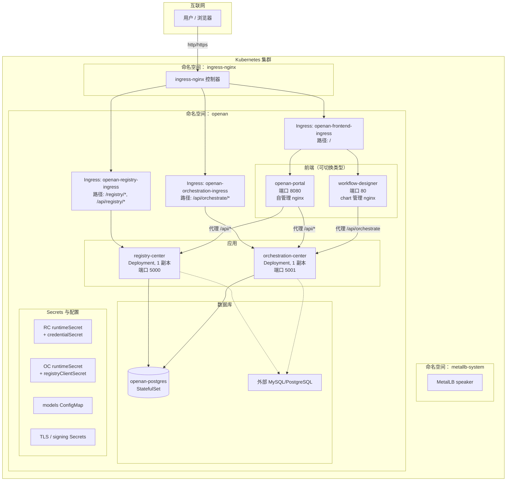
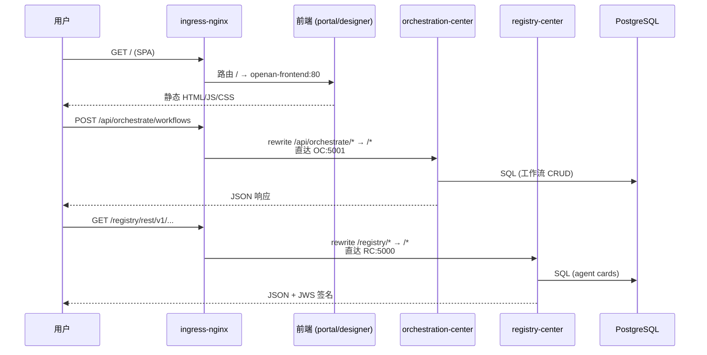
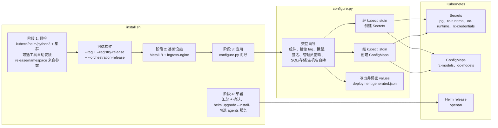
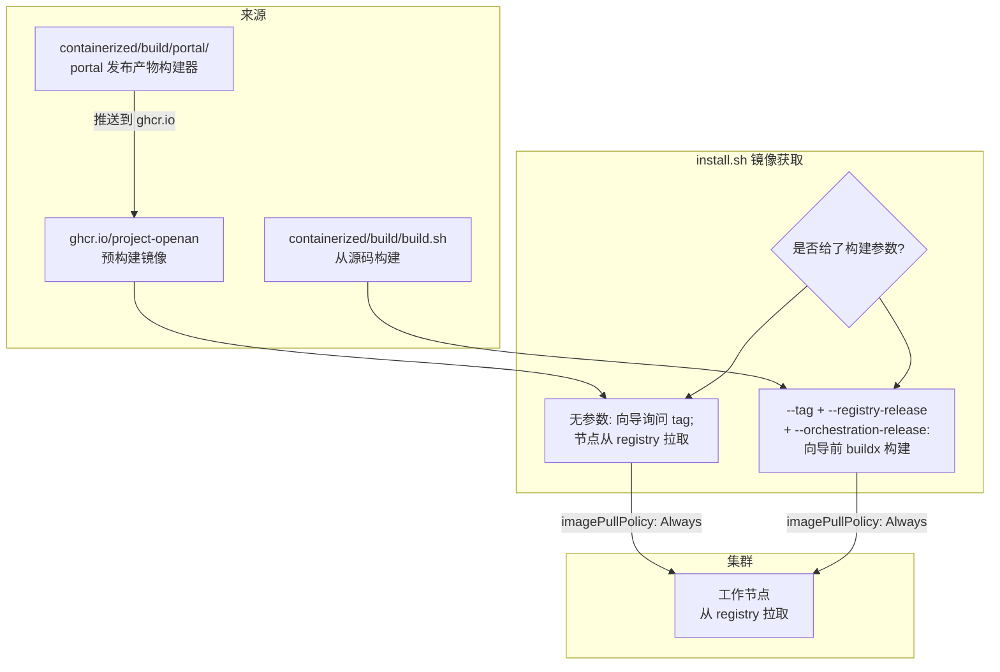
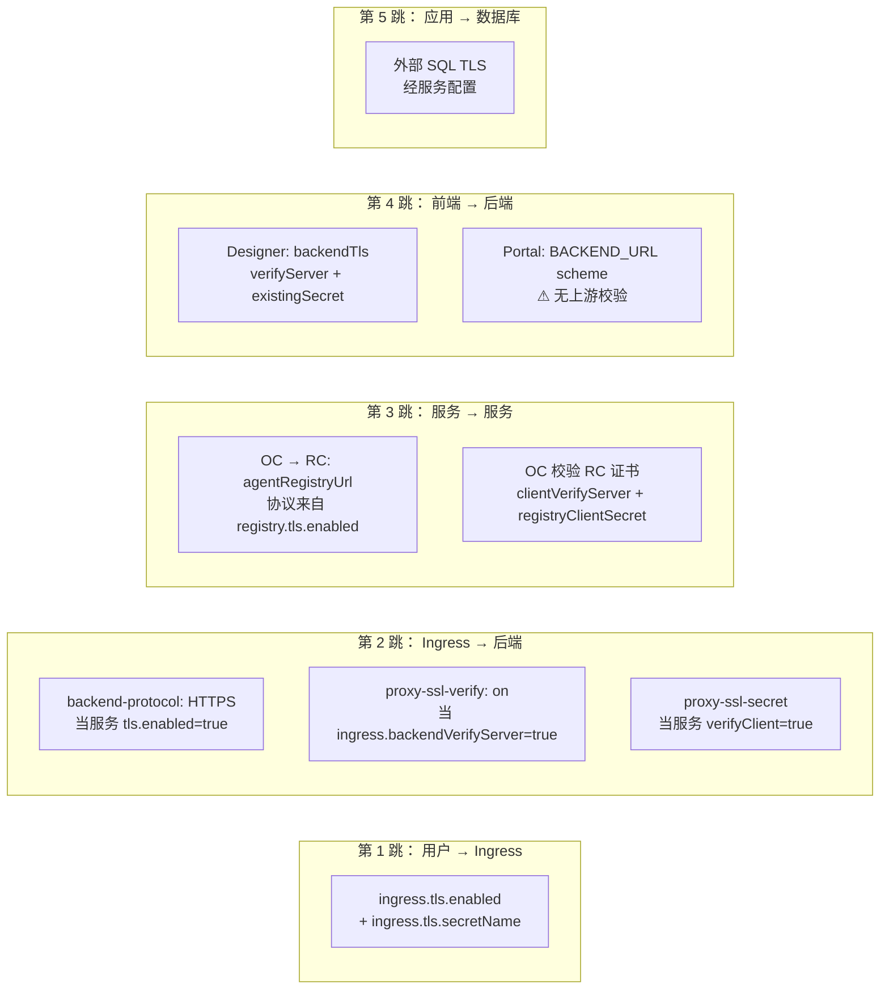

# 在线安装架构设计

[English](../en/online-install-architecture.en.md) | 中文

## 1. 概述

`containerized/online-install/` 交付件从镜像仓库（互联网或内部仓库）将OpenAN平台部署到既有Kubernetes集群。它由两个协作部分组成：

| 组成部分 | 产物 | 职责 |
|------|----------|------|
| Helm chart | `openan-chart/` | 声明式资源定义；集群中运行内容的唯一事实来源 |
| 安装器 | `install.sh` + `configure.py` | 编排预检、镜像获取、基础设施、引导式配置与 `helm upgrade --install` |

chart是**生产制品** —— 可直接 `helm install -f deployment.yaml` 部署，也是GitOps的接口。安装器是面向交互式评估与可脚本化CI的**便利层**；它绝不绕过chart。

### 范围

- 目标：可运行的Kubernetes集群（v1.25+），可访问互联网。
- 安装器提供MetalLB与ingress-nginx（或跳过），但不创建集群本身。
- portal镜像从registry拉取（绝不在此从源码构建）；专用portal构建器见 `containerized/build/portal/`。

### 非目标

- 集群创建（见 [KUBEADM_CLUSTER.md](../../containerized/offline-install/docs/KUBEADM_CLUSTER.md)）。
- 离线/无外网部署（K8s线见 [offline-install-architecture.zh.md](offline-install-architecture.zh.md)，Docker Compose线见 [offline-install-compose-architecture.zh.md](offline-install-compose-architecture.zh.md)）。
- registry-center / orchestration-center的镜像构建（见 [containerized/build/build.sh](../../containerized/build/build.sh)）；安装器可以调用它，但不拥有其逻辑。

---

## 2. 架构

### 2.1 部署拓扑



### 2.2 组件清单

| 资源 | 类型 | 名称 | 说明 |
|----------|------|------|-------|
| 注册中心 | Deployment | `registry-center` | 1 副本（进程内事件）；Recreate 策略 |
| 编排中心 | Deployment | `orchestration-center` | 1 副本（进程内会话）；Recreate 策略 |
| 前端（portal） | Deployment | `openan-frontend` | 默认 2 副本；HPA（Horizontal Pod Autoscaler，水平 Pod 自动扩缩）启用 |
| 前端（designer） | Deployment | `openan-frontend` | 默认 2 副本；HPA 启用；chart 管理 nginx |
| PostgreSQL | StatefulSet | `openan-postgres` | 仅当 `postgresql.enabled=true` |
| RC 运行时 PVC | PVC | `registry-center-runtime` | `helm.sh/resource-policy: keep` |
| OC 运行时 PVC | PVC | `orchestration-center-runtime` | `helm.sh/resource-policy: keep` |
| 本地 PV（回退） | PV | `openan-postgres-pv`、`openan-rc-pv`、`openan-oc-pv` | 仅当设置 `createPV`；节点固定 hostPath/local，单节点评估 |
| 前端 Ingress | Ingress | `openan-frontend-ingress` | 路径 `/` |
| 编排 Ingress | Ingress | `openan-orchestration-ingress` | 路径 `/api/orchestrate(/|$)(.*)` → rewrite |
| 注册 Ingress | Ingress | `openan-registry-ingress` | 路径 `/registry`、`/api/registry` → rewrite |
| 校验 | 模板 | `validate.yaml` | `fail` 期契约强制 |

### 2.3 外部依赖

| 依赖 | 管理方 | 说明 |
|------------|-----------|-------|
| ingress-nginx | 安装器阶段 [2/4] 或运维者 | 必须具有 `ingressClassName: nginx` |
| MetalLB | 安装器阶段 [2/4] 或运维者 | 仅在裸金属上为 LoadBalancer IP 所需 |
| 容器镜像 | `ghcr.io/project-openan`（默认） | `frontend.image.repository` 为空 → 由 `frontend.type` 派生 |
| 外部 SQL | 运维者提供 | 经 `database.type` 使用 MySQL 或外部 PostgreSQL（需审查 values；向导仅支持集群内） |
| StorageClass | 运维者提供 | 无 StorageClass 时向导回退到节点固定的本地 hostPath PV |

---

## 3. 组件设计

### 3.1 注册中心（Deployment）

**职责**：Agent Card（智能体卡片，描述智能体能力与接口的元数据）注册、发现、语义检索、JWS（JSON Web Signature）签名、令牌/证书身份。

**关键设计决策**：

- **强制单副本** —— 运行时事件侦听与分发为进程内态；`validate.yaml:37` 在 `replicas != 1` 时 `fail`，直到出现分布式协调机制。
- **Recreate策略** —— 而非RollingUpdate：RWO运行时PVC无法在surge时跨Pod共享。
- **非root安全上下文** —— `runAsUser: 10001`，丢弃所有capabilities，`allowPrivilegeEscalation: false`。
- **Init容器**在主容器启动前准备 `/runtime/{data,log}` 目录权限（fsGroup处理组访问，init容器保证目录以0770存在）。
- **配置校验和注解** —— Pod模板上的 `checksum/config` 与 `checksum/models` 在ConfigMap或models.yaml变化时强制滚动更新，无需更改镜像tag。

**卷布局**：

| 卷 | 来源 | 挂载 | 用途 |
|--------|--------|-------|---------|
| `runtime` | PVC（保留） | `/opt/registry-center/data`、`/opt/registry-center/log` | 持久数据与日志 |
| `models` | ConfigMap | `/opt/registry-center/etc/config/models.yaml`（subPath） | LLM 模型定义 |
| `tls` | Secret（0440） | `/opt/registry-center/etc/ssl/{server.cer,...}`（按 key subPath） | TLS 材料 |
| `signing` | Secret（0440） | `/opt/registry-center/etc/sign_cert/{sign.cer,...}` | JWS 签名密钥 |
| `credentials` | Secret（0440） | `/opt/registry-center/etc/conf/integration_credentials.conf` | 静态 Bearer / mTLS 条目 |

### 3.2 编排中心（Deployment）

**职责**：PSOP（Plan-Specific Operation Protocol，计划特定操作协议）生成、工作流执行、SSE（Server-Sent Events，服务器推送事件）流式输出、管理员引导、智能体编排。

**关键设计决策**：

- **单副本 + 无HPA** —— 会话为进程内态（内存中）；`validate.yaml:45` 在 `replicas != 1` 或 `hpa.enabled=true` 时 `fail`。
- **Recreate策略** —— 与RC相同的RWO PVC原因。
- **`agentRegistryUrl` 自动发现** —— `openan.registryUrl` helper根据registry的TLS设置派生 `http(s)://registry-center:<port>`；用户可用外部URL覆盖。
- **`clientVerifyServer`** —— 控制OC是否校验registry的TLS证书；registry走HTTPS时需要 `registryClientSecret`（trust.cer + 可选客户端证书）。

**卷布局**：与RC同模式（运行时PVC、models ConfigMap、TLS Secret、registry客户端Secret）。无signing卷（签名仅RC）。

### 3.3 前端（Deployment，可切换类型）

**职责**：统一Web入口；服务SPA并将API调用代理到后端。

**通过 `frontend.type` 实现两种模式**：

| 方面 | `portal`（默认） | `workflow-designer` |
|--------|-------------------|---------------------|
| 镜像 | `ghcr.io/project-openan/openan-portal` | `ghcr.io/project-openan/workflow-designer` |
| 容器端口 | 8080（非特权 nginx） | 80 |
| Nginx 配置 | 自管理（镜像内 envsubst 模板） | Chart 管理（ConfigMap，checksum 滚动） |
| 环境变量 | `BACKEND_URL`、`REGISTRY_URL`（协议跟随各后端 TLS） | 无（nginx 配置内置） |
| Upstream TLS 校验 | ❌ Portal 镜像无法校验上游 TLS | ✅ `backendTls.existingSecret`（trust.cer + 可选客户端证书） |
| 卷 | 无 | nginx-config ConfigMap、backend-tls Secret |

**开关的设计理由**：portal使用完全不同的构建流水线（npm → 静态资源 → nginx），独立构建与发布（`containerized/build/portal/`）。chart只需知道容器端口与环境变量契约 —— 其余归镜像负责。`repository` 为空时 `openan.frontendImageRepository` helper按类型派生镜像，保持values精简。

### 3.4 PostgreSQL（StatefulSet）

仅在 `postgresql.enabled=true` 且 `database.type=postgresql` 时渲染。

- 通过init脚本创建两个数据库/用户（`postgresql.databases` 列表）。
- 集群内模式下两个应用共享 `postgres-password`；集群内PG拒绝按应用 `existingSecret`（validate.yaml:76）。
- 存储：默认StorageClass，或显式 `storageClassName`，或 `-`（无类）。没有任何StorageClass时，`postgresql.storage.createStorageClass` + `createPV`/`useHostPath`/`nodeName` 创建共享的 `openan-local` 类与节点固定PV（单节点评估；向导自动启用）。

### 3.5 运行时PVC（`runtime-pvc.yaml`）

RC与OC各获得专用PVC（`<name>-runtime`），带 `helm.sh/resource-policy: keep` —— 卸载Helm release不会删除运行时数据。这是数据安全决策：PVC生命周期长于chart。在无StorageClass的集群上，`persistence.createPV`（加 `storageClassName`、`useHostPath`、`nodeName`、`pvName`）渲染匹配的节点固定PV（`openan-rc-pv` / `openan-oc-pv`）使声明得以绑定；仅限单节点评估，`uninstall.sh` 会检测并清理这些PV及其hostPath数据。

---

## 4. 数据流

### 4.1 请求流（用户 → 后端）



**要点**：portal前端在Pod内代理 `/api/orchestrate` 与 `/api/registry`；workflow-designer仅代理 `/api/orchestrate` 系列路径（供SPA发起的调用），Ingress同时把这些路径直接路由到后端（供绕过前端的API消费方）。两条路径无冲突共存。

### 4.2 配置流（安装器 → 集群）



**密钥处理**：`configure.py` 用 `getpass`（TTY保护）输入，经 `kubectl create -f -` 以stdin JSON创建Secrets —— 密钥从不出现在命令行参数、环境文件或values文件中。生成的values文件（`deployment.generated.json`）只含非机密引用（Secret/ConfigMap名、镜像tag、主机名）。

**示例智能体服务**：部署编排中心后，安装器交互式提供在orchestration-center Pod内经 `kubectl exec` + `nohup` 启动演示智能体（`samples/start_agents_server.py`）的选项，然后健康检查8903端口（日志：`/tmp/agents-server.log`）。它镜像离线安装器的 `START_AGENTS_SERVER` 选项，但属于部署后便利功能而非chart资源：不受Helm调和，Pod重启或升级后不存活。

**预检自动安装与部署门禁**：缺少kubectl/helm时提供自动安装 —— 仅用官方安装方式（`dl.k8s.io` 二进制、`get-helm-3`、macOS上存在时可用 `brew`），均需显式交互确认，安装后复查；python3始终保持手工；Docker（get.docker.com，Linux）仅在参数驱动的构建阶段提供。未经“yes”主机上不会安装任何东西。`helm upgrade --install` 前，安装器打印非机密部署摘要（release/namespace、组件、镜像tag、SQL、存储、模型、签名、ingress主机名）并要求确认；取消会保留生成的values文件与向导已创建的Secrets/ConfigMaps（向导非事务性）。非交互 `--values` 模式下两种行为都不存在：CI在工具缺失时快速失败，部署无提示。

### 4.3 镜像流



Portal **绝不**由安装器从源码构建 —— 从registry拉取。专用portal构建器（`containerized/build/portal/`）负责源码到镜像的流水线并发布到ghcr.io。

---

## 5. 配置契约

### 5.1 Values结构（顶层）

```yaml
namespace: string            # 必须与 helm --namespace 一致（受校验）
createNamespace: boolean
postgresql: {...}           # 集群内 PG（可选）
database: {...}             # SQL 类型/主机/端口 + 每应用 db/user/secret
registry: {...}             # RC：镜像、端口、副本数、llm、tls、signing、persistence
orchestration: {...}        # OC：镜像、端口、副本数、llm、tls、persistence
frontend: {...}             # type、image、port、nodePort、nginxConfig、backendTls
ingress: {...}              # enabled、className、host、tls、annotations
```

### 5.2 Secret引用模型

chart **从不生成凭证**。每个secret都是对既有Kubernetes Secret的引用：

| Secret | 键 | 被引用方 |
|--------|--------|---------------|
| `postgresql.existingSecret` | `postgres-password` | RC/OC DB_PASSWORD（集群内 PG） |
| `database.<app>.existingSecret` | `db-password`（或 `passwordKey`） | 每应用 DB_PASSWORD（外部 SQL） |
| `registry.runtimeSecret` | 环境变量（整包 envFrom） | RC Pod |
| `registry.credentialSecret` | `integration_credentials.conf` | RC Pod（挂载文件） |
| `registry.tls.existingSecret` | `server.cer`、`server_key.pem`、`cert_pwd`、`trust.cer` | RC Pod（挂载文件） |
| `registry.signing.existingSecret` | `sign.cer`、`sign_key.pem`、`cert_pwd` | RC Pod（挂载文件） |
| `orchestration.runtimeSecret` | `OC_ADMIN_INITIAL_PASSWORD`、`REGISTRY_ACCESS_TOKEN` | OC Pod（envFrom） |
| `orchestration.registryClientSecret` | `trust.cer`、`client.cer`、`client_key.pem` | OC → RC TLS |
| `orchestration.tls.existingSecret` | 同 RC TLS | OC Pod |
| `frontend.backendTls.existingSecret` | `trust.cer`（+ `client.cer`、`client_key.pem`） | Designer nginx upstream 校验 |

### 5.3 ConfigMap引用模型

| ConfigMap | 内容 | 被引用方 |
|----------|---------|---------------|
| `registry.modelsConfigMap` | `models.yaml`（完整 LLM 配置） | RC Pod（subPath 挂载） |
| `orchestration.modelsConfigMap` | `models.yaml` | OC Pod（subPath 挂载） |
| `openan-frontend-nginx-config` | `default.conf`（nginx） | Designer Pod（仅 designer 模式） |

### 5.4 校验规则（`validate.yaml`）

`validate.yaml` 模板是 **fail-fast契约强制器**，在 `helm template/lint/install` 时运行。它拒绝：

- 缺失镜像tag（无默认tag —— 强制显式固定版本）
- MySQL与 `postgresql.enabled=true` 并存（矛盾）
- RC/OC使用相同的外部数据库名
- RC/OC缺少 `runtimeSecret`
- `verifyClient=true` 但未启用TLS
- workflow-designer搭配OC TLS且 `backendTls.verifyServer`/`verifyClient` 时必须有 `backendTls.existingSecret`；portal类型不受此约束（portal无上游校验能力，属文档化限制）
- RC副本数 > 1（进程内事件）
- OC副本数 > 1或启用HPA（进程内会话）
- 集群内PG搭配按应用 `existingSecret`（集群内使用单一共享密码）
- `persistence.createPV` 缺少匹配的 `storageClassName`，或本地（非hostPath）PV缺少 `nodeName`（PV与PVC将无法绑定）
- 遮蔽托管设置的重复 `extraEnv` 键
- 遮蔽其他服务或SQL主机的探针主机配置

---

## 6. 安全

### 6.1 认证模型

chart为registry-center支持两种调用方身份模式：

| 模式 | 机制 | 要求 |
|------|-----------|-------------|
| `token`（默认） | 经 `integration.auth.*` provider 的 Bearer 令牌 | 带 `integration_credentials.conf` 的 `credentialSecret` |
| `certificate` | 客户端证书 mTLS | `tls.enabled=true` + `tls.verifyClient=true` |

orchestration-center有自己的认证：

| 路径 | 机制 | Secret |
|------|-----------|--------|
| `/api/v1/*`（外部） | 会话登录（管理员）+ Bearer 令牌 | runtimeSecret 中的 `OC_ADMIN_INITIAL_PASSWORD` |
| `/rest/v1/orchestrate/*`（内部） | 访问 RC 的服务令牌 | runtimeSecret 中的 `REGISTRY_ACCESS_TOKEN` |

### 6.2 TLS架构

TLS分层且每一跳可独立开关：



**关键设计决策**：每一跳的TLS相互独立。可以只有ingress处TLS（第1跳开、第2跳关、到后端明文HTTP），也可以服务间mTLS（第3跳开）而ingress明文。这种粒度是必要的，因为各跳证书不同（ingress用公共CA，服务间用内部CA，SQL用数据库CA）。

**已知限制**：portal镜像无法校验上游TLS（无CA注入点）。`frontend.type=portal` 且OC走HTTPS时，连接建立但不校验。`validate.yaml` 把 `backendTls` 要求限定在 `workflow-designer`。

### 6.3 JWS签名

registry-center为每个AgentCard加JWS签名。签名材料独立于TLS：

| `signing.mode` | 行为 |
|---------------|----------|
| `auto` | Helm 生成自签材料（仅演示） |
| `secret` | 引用既有 Secret（`sign.cer`、`sign_key.pem`、`cert_pwd`） |
| `off` | 不挂载签名卷 |

### 6.4 Pod安全

所有应用Pod以如下配置运行：

- `runAsUser: 10001`、`runAsGroup: 10001`、`fsGroup: 10001`
- `allowPrivilegeEscalation: false`
- `capabilities: drop: ["ALL"]`
- Secret卷 `readOnly: true` 且 `defaultMode: 0440`
- 用于目录权限准备的init容器

---

## 7. 可扩展性

### 7.1 新增后端组件

1. 增加 `values.yaml` 配置块（image、port、replicas、tls、persistence）。
2. 创建 `templates/<name>/deployment.yaml` + `service.yaml` + `configmap.yaml`（可选 `secret.yaml`、`hpa.yaml`）。
3. 在 `_helpers.tpl` 增加labels/selectorLabels helper。
4. 在 `validate.yaml` 增加校验规则。
5. 在 `ingress.yaml` 增加路径（如需对外可达）。
6. 在 `tests/test_deployment_contract.py` 增加契约测试。

### 7.2 新增数据库后端

`database.type` 字段是开放的（当前 `postgresql`|`mysql`）。在 `validate.yaml` 中加入新类型，在helpers中增加连接逻辑，并更新部署env接线。

### 7.3 新增前端类型

把类型名加入 `openan.frontendType`，在 `openan.frontendContainerPort` 设置容器端口，在 `openan.frontendImageRepository` 设置镜像默认，并在前端Deployment模板中加入模式分支。

### 7.4 已知非目标

- **RC多副本** —— 受分布式事件协调阻塞。
- **OC多副本** —— 受共享会话存储阻塞。
- **chart级镜像拉取/构建** —— chart假设镜像已存在于registry；它从不构建。
- **命名空间级RBAC** —— chart以Helm服务账号运行；细粒度RBAC留给运维者。

### 7.5 测试策略

所有契约测试（`tests/test_deployment_contract.py`）使用真实 `helm template` 渲染 —— 非mock —— 并断言渲染出的YAML。这保证chart对真实Helm行为有效。Compose契约测试（`tests/test_offline_compose_contract.py`）验证Compose生成器的输出遵循同一组架构决策。
