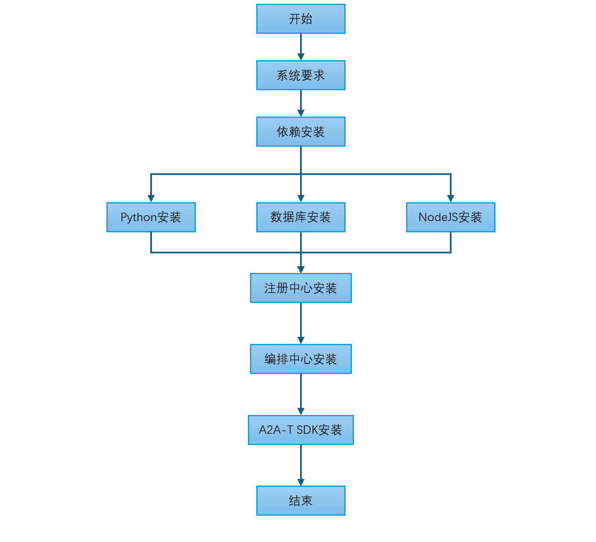

<!--
Copyright (c) 2026 Huawei Technologies Co., Ltd.
All Rights Reserved.

SPDX-License-Identifier: Apache-2.0

   Licensed under the Apache License, Version 2.0 (the "License"); you may
   not use this file except in compliance with the License. You may obtain
   a copy of the License at

        http://www.apache.org/licenses/LICENSE-2.0

   Unless required by applicable law or agreed to in writing, software
   distributed under the License is distributed on an "AS IS" BASIS, WITHOUT
   WARRANTIES OR CONDITIONS OF ANY KIND, either express or implied. See the
   License for the specific language governing permissions and limitations
   under the License.
-->
# OpenAN快速安装指导

[English](../en/quick-installation-guide.en.md) | 中文

> 本文面向开发者与交付运维人员，在首次部署/体验阶段，介绍使用openan-installation提供的系统级安装工具快速部署OpenAN：一条命令完成安装、校验与卸载，无需手工准备运行时与依赖。需要逐步掌控部署细节（自定义systemd服务、外接已有数据库、源码级部署）的场景，请见[手动安装指导](manual-installation-guide.zh.md)。
## 一、系统要求

整体软件安装流程如下：



**图1：OpenAN整体软件安装流程**

本项目基于Python 3.12开发，编译安装前请确保目标系统满足以下要求：

### 操作系统

| 操作系统 | 最低版本 |
|---------|---------|
| 其他 Linux 发行版 | 内核 3.10+ |
| CentOS / RHEL | 7.0+ |
| Ubuntu | 18.04+ |
| Debian | 10+ |
>  **说明：**<br />Python 3.12编译需要支持C11标准的编译器，GCC 5.0+ 可提供更好的优化支持。Glibc 2.17是Python 3.12的最低要求，建议使用2.28+ 以获得更好的兼容性。

### 验证系统环境

```bash
# 检查 GCC 版本
gcc --version

# 检查 Make 版本
make --version

# 检查 Glibc 版本
ldd --version
```

>  **说明：**<br />预期回显：三条命令均应输出版本号（如 `gcc (GCC) 4.8.5 ...`、`GNU Make 3.81`、`ldd (GNU libc) 2.17`）。判断标准：输出版本号且不低于上表对应工具的最低版本即通过；不满足最低版本时需先升级对应工具后再继续安装。

| 工具 | 最低版本 | 推荐版本 | 查看命令 |
|-----|---------|---------|---------|
| GCC | 4.8.5 | 5.0+ | `gcc --version` |
| Make | 3.81 | 4.0+ | `make --version` |
| Glibc | 2.17 | 2.28+ | `ldd --version` |
>  **说明：**<br />Python 3.12编译需要支持C11标准的编译器，GCC 5.0+ 可提供更好的优化支持。Glibc 2.17是Python 3.12的最低要求，建议使用2.28+ 以获得更好的兼容性。

### 硬件部署建议资源
| 节点类型   | 主节点数量 | 从节点数量 | vCPU(个) | 内存(GB) | 硬盘        |
|--------|-------|-------|---------|--------|-----------|
| 注册中心节点 | 1     | 1     | 2       | 4      | 系统盘>=100G |
| 编排中心节点 | 1     | 1     | 2       | 4      | 系统盘>=100G |
| 数据库节点  | 1     | 1     | 2       | 4      | 系统盘>=100G |

### 最小部署建议资源
| 节点类型   | 主节点数量 | 从节点数量 | vCPU(个) | 内存(GB) | 硬盘       |
|--------|-------|-------|---------|--------|----------|
| 注册中心节点 | 1     | 0     | 1       | 2      | 系统盘>=50G |
| 编排中心节点 | 1     | 0     | 1       | 2      | 系统盘>=50G |
| 数据库节点  | 1     | 0     | 1       | 2      | 系统盘>=50G |

### 节点要求

在线环境要求节点可以连通外部网络；离线环境需提前在网络已连通的Linux机器（与目标服务器架构一致，x86_64或aarch64）上下载依赖包，再传输到目标节点安装（离线安装方案参见 [§2.2二进制离线安装](#22-二进制离线安装离线单机--vm)）。<br>
节点可以使用root用户登录。<br>
引导节点上需要安装tar工具。
>  **须知：**<br />建议您的节点环境足够干净，未安装任何Kubernetes组件（该要求仅针对容器化集群安装方式；二进制单机安装不适用），否则可能会发生版本冲突导致安装失败。

---

### 动手前自检清单

- [ ] 操作系统与内核满足[操作系统](#操作系统)表；GCC / Make / Glibc满足[工具版本要求](#验证系统环境)
- [ ] 硬件资源达到对应角色的[部署建议资源](#硬件部署建议资源)（或[最小部署建议资源](#最小部署建议资源)）
- [ ] 目标节点环境干净：未安装任何Kubernetes组件（仅集群安装要求；二进制单机安装不适用）；tar工具可用
- [ ] 在线环境：节点可访问外网；离线环境：已在同架构联网机器准备好全部制品（依赖包 / 离线包 / bundle）
- [ ] 集群方式（容器化在线 / 容器化离线安装）：kubectl可用且具备管理员权限；离线方式另需每个节点containerd信任集群内私有仓库（见 [DEPENDENCIES §2.2](../../containerized/offline-install/docs/DEPENDENCIES.md)）

## 二、安装方式对比与选型

openan-installation提供统一的系统级安装工具，覆盖"单机二进制"与"集群容器化"两类目标环境，支持模块化组件选择（仅注册中心 / 仅编排中心 + 前端 / 全量）与集中式变量配置（密钥、证书、镜像源、网络参数）。按目标环境选择：

| 安装方式 | 目标环境 | 前置条件 | 入口 | 详细文档 |
|---|---|---|---|---|
| 二进制一键安装 | 有外网的单机 / 开发环境 | Linux（root）、curl、外网访问 | `binary/one-click/install.sh` | [QUICKSTART](../../binary/one-click/QUICKSTART.md) |
| 二进制离线安装 | 无外网的单机 / VM | 离线安装包、root | `binary/offline-install/install.sh` | [QUICKSTART](../../binary/offline-install/QUICKSTART.md) |
| 容器化在线安装 | 有外网的 Kubernetes 集群（v1.33+） | kubectl / Helm、集群管理员权限 | `containerized/online-install/install.sh` | [QUICKSTART](../../containerized/online-install/QUICKSTART.md) |
| 容器化离线安装 | 无外网的 Kubernetes 集群（v1.33+） | 联网机器构建离线 bundle、kubectl | `containerized/offline-install/scripts/install.sh --config config.env` | [QUICKSTART](../../containerized/offline-install/QUICKSTART.md) |
| 离线 Compose 安装 | 无外网的单机容器化环境 | Docker（Compose v2.20+）、Python 3.10+ | `scripts/install.sh --config config.env` | [QUICKSTART](../../containerized/offline-install-compose/QUICKSTART.md) |

每个方式的步骤统一为：**准备 → 配置项 → 安装 → 校验 → 卸载**。

>  **须知：**<br />常见失败场景与排查：① 端口冲突——按安装器输出的占用进程释放端口后重试；② 镜像拉取失败——检查网络与镜像源配置后重试；③ Pod不就绪——执行 `kubectl -n openan describe pod <pod>` 查看事件定位；④ 离线包校验失败——确认tarball完整传输后重试。各方式详细排障见对应QUICKSTART：[2.1](../../binary/one-click/QUICKSTART.md) / [2.2](../../binary/offline-install/QUICKSTART.md) / [2.3](../../containerized/online-install/QUICKSTART.md) / [2.4](../../containerized/offline-install/QUICKSTART.md) / [2.5](../../containerized/offline-install-compose/QUICKSTART.md)。

>  **快速选型：**<br />开发体验 / 有网单机 → 2.1（离线单机 → 2.2）；离线单机容器化 → 2.5；有网生产集群 → 2.3；离线生产集群 → 2.4；需要systemd定制、外接已有数据库或源码级部署 → [手动安装指导](manual-installation-guide.zh.md)。

### 2.1 二进制一键安装（在线环境）

面向开发者与轻量体验：自动探测并安装Python 3.12+ / Node.js 20.19+ / nginx / openssl（已装则跳过，缺失三层回退），自动拉取registry-center、orchestration-center的Release制品，自动配置nginx HTTPS统一入口（`/`、`/api/orchestrate/`、`/registry/` 三条路由）。

- **准备**：一台可访问外网（GitHub / PyPI / Node官方源）的Linux主机，root权限。
- **配置项**（安装时交互提示，均有默认值，可直接回车）：
  - 组件选择：`--reg` / `--orc`（命令行传入；缺省全量；仅装OC（orchestration-center，编排中心）时需提供远程RC（registry-center，注册中心）地址）
  - LLM端点：模型名 / API URL / API Key（掩码输入，可跳过，安装后补配）
  - 数据库密码、管理员密码等敏感项
- **安装**：

```bash
git clone https://github.com/project-openan/openan-installation.git
cd openan-installation/binary/one-click
./install.sh                 # 交互安装；--reg / --orc 选择组件，缺省全量
```

- **校验**：安装器自检各进程存活与端口监听（输出PID与日志路径）；随后验证统一入口：

```bash
curl -sk -o /dev/null -w '%{http_code}\n' \
  https://127.0.0.1/registry/rest/v1/registry-center/agent-cards   # 期望非 5xx
```

浏览器访问 `https://<主机IP>/` 应打开前端页面。

- **卸载**：

```bash
./uninstall.sh               # 移除项目目录与 nginx 配置；保留 Python/Node/nginx 等运行时，便于重装
```

完整说明见 [binary/one-click/QUICKSTART.md](../../binary/one-click/QUICKSTART.md)。

### 2.2 二进制离线安装（离线单机 / VM）

面向无外网的单机交付：离线包自带venv与前端制品，运行时安装、端口冲突清理、nginx入口配置全自动，流程与一键安装一致。

- **准备**：组件离线包（由 `binary/build/pack.sh` 在联网机按组件独立打包，产物为 `dist/` 下的 `registry-center-<version>-linux.tar.gz` 与 `orchestration-center-<version>-linux.tar.gz`，见 [binary/build/QUICKSTART](../../binary/build/QUICKSTART.md)）。
- **配置项**：与2.1相同（交互提示；LLM端点可跳过）。
- **安装**：将 `dist/` 下的组件tarball与 `binary/offline-install/` 目录下的 `install.sh` / `uninstall.sh` / `configure_llm.sh` 放到**同一目录**（install.sh会先在 `dist/` 查找、再在脚本所在目录查找tarball），`chmod +x` 后执行：

```bash
chmod +x install.sh uninstall.sh configure_llm.sh
./install.sh                       # 自动探测并安装可用组件包；参数同一键安装
./configure_llm.sh --reg --orc   # 安装后补配 / 重配 LLM（支持连通性校验与掩码输入）
```

- **校验**：同2.1（进程 / 端口自检 + 统一入口API smoke）。
- **卸载**：

```bash
./uninstall.sh               # 保留运行时工具链，重装更快
```

完整说明见 [binary/offline-install/QUICKSTART.md](../../binary/offline-install/QUICKSTART.md)。

### 2.3 容器化在线安装（Kubernetes）

面向生产集群（有外网）：基于Helm chart，模块化组件选择，数据库、协议、证书、镜像源全参数可配；支持交互向导或 `--values` 无人值守。

- **准备**：Kubernetes **v1.33+** 集群、kubectl访问、集群管理员权限；helm缺失时向导可自动安装（官方源，需确认）。
- **配置项**（向导交互或 `--values` 部署文件）：
  - release名称 / 命名空间；组件开关（registry / orchestration / frontend）
  - 镜像tag与前端类型（`portal` / `workflow-designer`）
  - 数据库：集群内PostgreSQL，或外部MySQL / PostgreSQL的连接信息与凭证Secret
  - LLM端点：chat / embed / rerank模型（向导写入models.yaml并创建Secret）
  - 管理员初始密码（`OC_ADMIN_INITIAL_PASSWORD`）与registry访问令牌
  - ingress主机名与TLS（可选）
- **安装**（预估10–20分钟，受网络与集群环境影响）：

```bash
git clone https://github.com/project-openan/openan-installation.git
cd openan-installation/containerized/online-install
./install.sh                     # 交互向导
# 或无人值守：./install.sh --values <部署文件>
```

- **校验**：

```bash
helm status openan -n openan
kubectl -n openan get pods       # 全部 Running / Ready
curl -s -o /dev/null -w '%{http_code}\n' \
  http://<ingress-IP>/registry/rest/v1/registry-center/agent-cards   # 期望非 5xx
```

>  **说明：**<br />判断标准：`helm status` 显示 `STATUS: deployed`，且 `kubectl get pods` 中所有Pod均为 `Running`、`READY` 就绪即成功；否则先执行 `kubectl -n openan describe pod <pod>` 排查事件。

>  **入口协议：**<br />默认HTTP；若部署时启用了ingress TLS（`ingress.tls.enabled` + 证书Secret），改用 `https://<ingress 地址>/` 访问（`ingress.host` 可为域名或IP；自签证书加 `-k` 或 `--cacert <CA 文件>`）。集群内服务间TLS对curl不可见，无需关注。

- **卸载**：

```bash
./uninstall.sh                   # 一键卸载；按提示选择是否清理数据
```

完整说明见 [containerized/online-install/QUICKSTART.md](../../containerized/online-install/QUICKSTART.md)。

### 2.4 容器化离线安装（Kubernetes离线bundle）

面向离线生产集群：在联网机器上构建自包含bundle（镜像、Helm、工具链全部固化），传输到离线集群后单命令安装 —— 自动引导集群内私有镜像仓库、离线安装MetalLB与ingress-nginx、Helm部署并自检，集群内TLS默认开启。

- **准备**：
  - 联网构建机：Docker + 外网访问（用于构建bundle）
  - 离线集群：kubeadm自建 **v1.33+**；**每个节点**的containerd已信任集群内私有仓库 `<REGISTRY_NODE_IP>:30500`（配置方法见 [DEPENDENCIES §2.2](../../containerized/offline-install/docs/DEPENDENCIES.md)）
  - 安装节点：kubectl可用、磁盘余量 ≥ 20 GB
- **配置项**（`config.env` 关键项，`cp config.env.example config.env` 后填写）：
  - `METALLB_POOL`：裸金属LB地址池（如 `192.168.1.200-192.168.1.250`）
  - `DB_PASSWORD`：数据库密码，必填、≥ 8字符
  - `OC_ADMIN_PASSWORD`：门户管理员初始密码，必填
  - `REGISTRY_CHAT_*` / `ORCH_CHAT_*`：LLM端点（离线默认不做连通性校验）
  - `HTTPS_ENABLED`：默认 `true`（安装时自动生成自签证书）
  - 可选：`INGRESS_HOST`、`STORAGE_MODE` / `STORAGE_CLASS`
  - 完整可直接使用的示例见 [config.env.example](../../containerized/offline-install/config.env.example)，各字段含义、默认值与取值范围以文件内注释为准。
- **安装**（联网构建bundle约20–60分钟，受网络与镜像架构影响；离线集群安装约10–20分钟）：

```bash
# 联网构建机
cd openan-installation/containerized/offline-install/build
./build-offline.sh --tag v1.0.0 --app-source pull

# 离线集群（拷贝 tarball 后）
tar -xzf openan-offline-v1.0.0.tar.gz && cd openan-offline-v1.0.0
cp config.env.example config.env   # 按上文填写
sudo scripts/install.sh --config config.env
```

- **校验**：安装器自检（Pod就绪、registry catalog、API smoke）；随后可手动复核：

```bash
kubectl -n openan get pods,ingress,svc
curl -s -o /dev/null -w '%{http_code}\n' \
  https://<INGRESS_HOST>/registry/rest/v1/registry-center/agent-cards   # 期望非 5xx
# 未设置 INGRESS_HOST 时入口为明文：http://<LB_IP>/registry/rest/v1/registry-center/agent-cards
```

>  **说明：**<br />判断标准：Pod全部 `Running`/`Ready` 且入口API返回非5xx即成功；否则按 §二开头的失败处理指引，先用 `kubectl -n openan describe pod <pod>` 定位不就绪原因。

>  **入口协议：**<br />未设置 `INGRESS_HOST` 时入口为 `http://<LB_IP>/`（与安装器自检输出一致，示例即此场景）；设置 `INGRESS_HOST` 并配置公共证书后，入口变为 `https://<INGRESS_HOST>/`。`INGRESS_HOST` 也可以是IP地址（MetalLB VIP或节点IP），证书自动签入对应SAN，实现 `https://<IP>/` 直连（见offline-install QUICKSTART “In-cluster HTTPS (default on)”）。

- **卸载**：

```bash
scripts/uninstall.sh --config config.env   # 可选删除数据卷与 hostPath；ingress-nginx / MetalLB 等共享基础设施默认保留
```

完整说明见 [containerized/offline-install/QUICKSTART.md](../../containerized/offline-install/QUICKSTART.md)；前置要求与故障排查见 [DEPENDENCIES](../../containerized/offline-install/docs/DEPENDENCIES.md)。

### 2.5 离线Compose安装（Docker）

面向离线单机的容器化快速体验：不需要Kubernetes，内置MySQL + RC + OC + 前端 + nginx。

- **准备**：单台Linux主机，Docker + Compose v2.20+，Python 3.10+（仅标准库；这是安装器脚本configure.py的要求，平台服务运行在容器镜像自带运行时中），root权限。
- **配置项**（`config.env`）：`DATABASE_TYPE`（默认内置mysql；生产建议外部SQL）、`FRONTEND_TYPE`（`portal` / `workflow-designer`）、`PUBLIC_ENABLE_HTTPS` / `PUBLIC_TLS_DIR`、RC / OC的TLS目录与LLM端点项。全部密钥由运维预置（models.yaml / env文件 / 凭证文件，按该目录QUICKSTART Step 3准备）；完整可直接使用的示例见 [config.env.example](../../containerized/offline-install-compose/config.env.example)。
- **安装**（离线包安装约5–10分钟，受主机性能与环境影响）：

```bash
cd openan-offline-compose-<version>
cp config.env.example config.env   # 按该目录 QUICKSTART 准备全部配置（含密钥）
sudo scripts/check-env.sh --config config.env
sudo scripts/install.sh --config config.env
```

>  **注：**<br />一键评估模式 `./install.sh --eval`（随机密钥零交互）依赖compose线的eval支持（PR #37），合并后可用。

- **校验**：

```bash
docker compose -f runtime/compose.json ps   # 全部服务 healthy / running
curl -s -o /dev/null -w '%{http_code}\n' http://<主机IP>:8080/   # 统一入口（默认 PUBLIC_PORT 8080）
```

- **卸载**：

```bash
sudo scripts/uninstall.sh        # 依据 runtime/compose.json 精确卸载；数据卷与配置保留，重装复用
```

完整说明见 [containerized/offline-install-compose/QUICKSTART.md](../../containerized/offline-install-compose/QUICKSTART.md)。

>  **提示：**<br />采用上述任一快速安装方式后，可跳过[手动安装指导](manual-installation-guide.zh.md)的对应步骤；该指南仍适用于需要自定义systemd服务管理、外接已有数据库集群、或逐组件源码级部署的场景。

